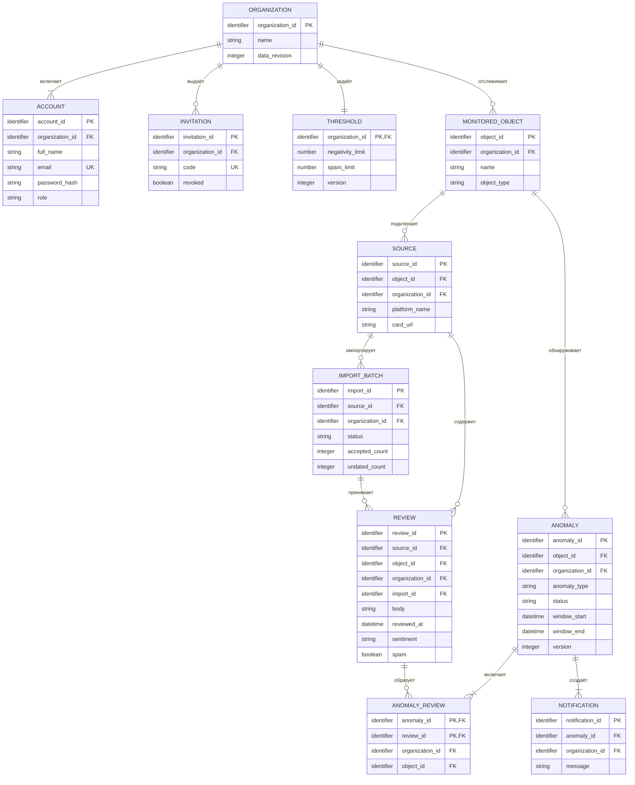

# Логическая схема БД

Логическая модель описывает данные ReviewGuard и связи между ними. Типы конкретной СУБД здесь не фиксируются. Названия совпадают с моделью предметной области. Служебные объекты, которых нет на диаграмме классов, добавлены там, где без них нельзя выполнить сценарии и нефункциональные требования: партия импорта, снимок показателей аномалии, версия изменяемой строки и сеанс.

Постоянные данные хранит PostgreSQL. Redis хранит сеанс, счётчик неудачных входов, ключ идемпотентности, код смены пароля, кэш дашборда и сигнал обработчику о новой партии. Отзывы и аномалии в Redis не записываются. Открытый пароль в Redis не записывается.

## ER-диаграмма

Глагол на линии читается от левой сущности к правой.

## Отношения

| Отношение | Ключ | Атрибуты и связи |
| --- | --- | --- |
| Организация | `organization_id` | Название. `data_revision` увеличивается, когда меняются данные, от которых зависит дашборд или список аномалий |
| Учётная запись | `account_id` | Имя, уникальный email, хэш пароля, роль. Ровно одна организация |
| Приглашение аналитика | `invitation_id` | Код и признак отзыва. Принадлежит одной организации |
| Пороги аномалий | `organization_id` | Предел негатива, предел спама, версия строки. Один набор на организацию |
| Объект мониторинга | `object_id` | Название и тип: товар или услуга. Принадлежит одной организации |
| Источник отзывов | `source_id` | Название площадки и ссылка на карточку. Один объект и та же организация |
| Партия импорта | `import_id` | Источник, статус обработки, число принятых отзывов и число отзывов без пригодной даты |
| Отзыв | `review_id` | Текст, дата из выгрузки или её отсутствие, тональность и признак вероятного спама после обработки. Один источник, одна партия |
| Аномалия | `anomaly_id` | Тип, статус разбора, окно, снимок показателей, версия строки. Один объект |
| Рассматриваемый отзыв | `(anomaly_id, review_id)` | Отзыв входит в аномалию того же объекта и той же организации |
| Внутреннее оповещение | `notification_id` | Сообщение и переход к одной аномалии. Видно участникам этой организации |

У организации хотя бы одна учётная запись: её создаёт регистрация. Гость отдельной записью не становится. Администратор и аналитик различаются ролью, а не отдельным отношением.

У объекта может не быть источников. У источника может не быть отзывов. Аномалия появляется только вместе хотя бы с одним отзывом своего окна и с одним оповещением: это одна транзакция обработчика. Внешний ключ сам по себе не требует, чтобы дочерняя строка уже существовала.

## Целостность

Организация изолирована по всей цепочке. Источник хранит и объект, и организацию. Отзыв хранит источник, объект и организацию. Аномалия хранит объект и организацию. Связь отзыва с аномалией требует совпадения объекта и организации у обеих сторон. Так нельзя привязать отзыв одной организации к аномалии другой и нельзя положить в карточку отзыв другого товара.

Email уникален без учёта регистра на весь сервис. Учётная запись не состоит в двух организациях и хранит одну роль. Успешное присоединение по коду своей организации оставляет `organization_id` и ставит эту роль в аналитика. Учётная запись другой организации не переносится. Код приглашения уникален. Отзыв кода оставляет строку и уже созданные учётные записи.

Тональность принимает одно из трёх значений и только после обработки. Пустое значение означает, что классификация партии ещё не закончена. Признак вероятного спама допустим только у отзыва с известной датой. Отсутствие даты не заполняется временем импорта.

Пороги и статус аномалии хранят версию. Сохранение передаёт ту версию, которую видел сотрудник. Устаревшая версия не затирает чужое изменение. Смена порогов не меняет уже записанный статус и не переписывает снимок показателей.

Название объекта не копируется в отзыв и в аномалию. Доли тональностей и точки динамики не хранятся отдельными строками: их считает запрос. В аномалии сохраняется снимок на момент обнаружения, потому что карточка должна показывать показатели того окна и после следующей загрузки.

Партия импорта не ищет повтор текста среди старых отзывов. Новый файл пользователя — новая партия. Повтор того же HTTP-запроса различается ключом идемпотентности в Redis, а не сравнением текстов.

## Правила, которые не являются колонками

Короткое окно — 24 часа, базовый период — 14 суток до начала этого окна. Конец интервала не входит в выборку. Эти длины одинаковы для всех организаций и не входят в набор порогов.

Предел негатива и предел спама — множители. Аномалия открывается, если в окне не меньше 5 датированных отзывов, базовый период тоже содержит не меньше 5 датированных отзывов, и доля отмеченных отзывов в окне не ниже доли базового периода, умноженной на предел. Для негатива отмечены отзывы с негативной тональностью, для спама — с признаком вероятного спама. Если базы меньше 5 отзывов, аномалия не открывается и это состояние не показывается как отсутствие негатива. Один и тот же прогон может открыть оба типа.

## Redis

| Ключ | Значение | Зачем |
| --- | --- | --- |
| `session:{id}` | `account_id` и признак CSRF | Сеанс после входа. Срок бездействия 30 минут, продлевается успешным чтением. Роль и организация читаются из `account` |
| `login:fail:{email}` | Счётчик и момент ограничения | Не больше 10 неуспешных входов за 5 минут, затем пауза не меньше 1 минуты. Ключ по `lower(email)`, общий для входа и присоединения |
| `idem:register:{key}` | Идентификатор уже созданной организации | Повтор регистрации с тем же ключом не открывает вторую организацию. Учётной записи на этом шаге ещё нет |
| `idem:accept:{key}` | Идентификатор уже созданной учётной записи | Повтор присоединения нового аналитика не создаёт вторую запись. В начале запроса учётной записи ещё нет |
| `idem:{account}:{key}` | Результат уже выполненного запроса | Повтор того же сохранения не создаёт вторую запись и не применяет статус, пороги или правку ещё раз. Срок 24 часа |
| `pwd:{account_id}` | Код и хэш нового пароля | Подтверждение смены пароля. Срок 10 минут. После верного кода ключ удаляется. Открытый пароль не хранится |
| `dash:v1:{org}:{revision}:{object}:{from}:{to}` | JSON сводки | Кэш дашборда. Без выбранного объекта сегмент object равен `all`. Новая ревизия организации делает старый ключ неиспользуемым |
| `queue:import` | Идентификаторы партий | Сигнал обработчику. Сама партия и отзывы остаются в PostgreSQL |

Сеанс не связан внешним ключом с учётной записью: в PostgreSQL нет таблицы сеансов. Открытый пароль, текст отзыва и содержимое сеанса в ключи Redis не входят. В `pwd:{account_id}` лежат код подтверждения и уже посчитанный хэш нового пароля.
