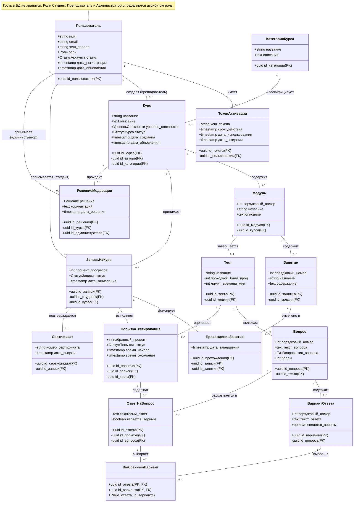
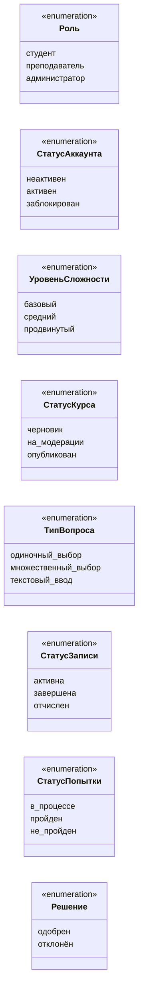

# Логическая схема базы данных

## 1. Назначение и основания модели
Документ описывает логическую модель базы данных веб-приложения для организации онлайн-обучения и тестирования команды № 10 без привязки к синтаксису конкретной СУБД. Модель разработана на основании «Модель предметной области.md», «Варианты использования.md», «Сценарии.md» и макетов «04-Дизайнер».

---

## 2. Логическая диаграмма классов базы данных

> **Пояснения к схеме:**
> 1. **Гость в базе данных не хранится**: неавторизованному посетителю не соответствует персистентная запись. Специализированные классы `Студент`, `Преподаватель`, `Администратор` из модели предметной области объединены в сущность `Пользователь` через атрибут `роль`.
> 2. **Связующие сущности и классы-ассоциации**: связь «многие-ко-многим» между студентом и курсом реализована через `ЗаписьНаКурс`; отметки прохождения уроков и попытки тестирования локализованы строго внутри зачисления (`ПрохождениеЗанятия`, `ПопыткаТестирования`); множественный выбор вариантов ответа вынесен в ассоциативную сущность `ВыбранныйВариант` с составным первичным ключом `(id_ответа, id_варианта)`.
> 3. **Технические сущности сценариев**: `ТокенАктивации`, `ОтветНаВопрос`, `ВыбранныйВариант` и `РешениеМодерации` добавлены для реализации процессов подтверждения почты, сохранения протокола тестирования и аудита модерации.

---

## 3. Перечисления доменных значений

---

## 4. Перечень отношений и логические ключи

| Логическая сущность | Таблица в физической схеме | Первичный ключ | Внешние ключи | Уникальные ключи и ограничения |
|---|---|---|---|---|
| `Пользователь` | `users` | `id_пользователя` | — | `email` |
| `ТокенАктивации` | `email_activation_tokens` | `id_токена` | `id_пользователя → Пользователь` | `хеш_токена` |
| `КатегорияКурса` | `categories` | `id_категории` | — | `название` |
| `Курс` | `courses` | `id_курса` | `id_автора → Пользователь`, `id_категории → КатегорияКурса` | — |
| `Модуль` | `modules` | `id_модуля` | `id_курса → Курс` | `(id_курса, порядковый_номер)` |
| `Занятие` | `lessons` | `id_занятия` | `id_модуля → Модуль` | `(id_модуля, порядковый_номер)` |
| `Тест` | `tests` | `id_теста` | `id_модуля → Модуль` | `id_модуля` |
| `Вопрос` | `questions` | `id_вопроса` | `id_теста → Тест` | `(id_теста, порядковый_номер)` |
| `ВариантОтвета` | `answer_options` | `id_варианта` | `id_вопроса → Вопрос` | `(id_вопроса, порядковый_номер)` |
| `ЗаписьНаКурс` | `enrollments` | `id_записи` | `id_студента → Пользователь`, `id_курса → Курс` | `(id_студента, id_курса)` |
| `ПрохождениеЗанятия` | `lesson_completions` | `id_прохождения` | `id_записи → ЗаписьНаКурс`, `id_занятия → Занятие` | `(id_записи, id_занятия)` |
| `ПопыткаТестирования` | `test_attempts` | `id_попытки` | `id_записи → ЗаписьНаКурс`, `id_теста → Тест` | — |
| `ОтветНаВопрос` | `attempt_answers` | `id_ответа` | `id_попытки → ПопыткаТестирования`, `id_вопроса → Вопрос` | `(id_попытки, id_вопроса)` |
| `ВыбранныйВариант` | `attempt_answer_options` | `(id_ответа, id_варианта)` | `id_ответа → ОтветНаВопрос`, `id_варианта → ВариантОтвета` | составной первичный ключ |
| `Сертификат` | `certificates` | `id_сертификата` | `id_записи → ЗаписьНаКурс` | `id_записи`, `номер_сертификата` |
| `РешениеМодерации` | `moderation_decisions` | `id_решения` | `id_курса → Курс`, `id_администратора → Пользователь` | — |

---

## 5. Логические ограничения и правила

1. **Ролевая модель:** Роль в `Пользователь` принимает одно из значений перечисления `Роль`. Публичная регистрация разрешает выбор только роли студента или преподавателя; учётная запись администратора создаётся служебным путём.
2. **Публикация и модерация курсов:** Черновик курса может создаваться без модулей и тестов, однако перевод курса в статус `на_модерации` и `опубликован` допускается только при наличии заполненной учебной программы. Отклонение курса обязательно сопровождается заполнением поля `комментарий` в `РешениеМодерации` и возвратом статуса в `черновик`.
3. **Зачисление и обучение:** Сущность `ЗаписьНаКурс` создаётся только для пользователя с ролью студента и курса в статусе `опубликован`. Уникальность пары `(id_студента, id_курса)` исключает повторное зачисление; уникальность `(id_записи, id_занятия)` в `ПрохождениеЗанятия` предотвращает дублирование отметок.
4. **Тестирование знаний:** При старте `ПопыткаТестирования` фиксируется время начала; проверка ответов выполняется на сервере после завершения попытки или истечения `лимит_времени_мин`. Попытка получает статус `пройден` при условии `набранный_процент >= проходной_балл_проц`.
5. **Расчёт прогресса и сертификация:** `процент_прогресса` и `набранный_процент` ограничены диапазоном `0..100`. Прогресс вычисляется по завершённым занятиям и успешно сданным тестам в рамках конкретной записи на курс. При 100% освоении и включённом модуле сертификации формируется не более одного `Сертификат` на одну `ЗаписьНаКурс`.
6. **Информационная безопасность:** В базе данных сохраняются исключительно хеши паролей и токенов активации; эталонные признаки `является_верным` в `ВариантОтвета` не передаются студенту до завершения попытки тестирования.

---

## 6. Нормализация данных

Логическая модель приведена к **третьей нормальной форме (3НФ)**:
- Все атрибуты сущностей атомарны (1НФ), справочники категорий и перечисления отделены от транзакционных записей;
- Все неключевые атрибуты полностью функционально зависят от первичного ключа (2НФ);
- Транзитивные зависимости между неключевыми атрибутами исключены (3НФ).

Связи «многие-ко-многим» декомпозированы в отдельные отношения (`ЗаписьНаКурс`, `ПрохождениеЗанятия`, `ВыбранныйВариант`). Атрибуты `процент_прогресса` и `набранный_процент` представляют собой контролируемые производные показатели, пересчитываемые транзакционно при изменении учебных достижений.

---

## 7. Связь с артефактами требований

| Сущности логической схемы | Исходные прецеденты и бизнес-процессы |
|---|---|
| `Пользователь`, `ТокенАктивации` | БП-1.1, БП-1.2, БП-1.3; ВИ-1.1, ВИ-1.2, ВИ-1.3, ВИ-1.4 |
| `КатегорияКурса`, `Курс`, `Модуль`, `Занятие` | БП-2.1, БП-2.3; ВИ-2.1, ВИ-2.2, ВИ-4.1, ВИ-4.2, ВИ-5.2 |
| `Тест`, `Вопрос`, `ВариантОтвета` | БП-2.2; ВИ-4.3 |
| `ЗаписьНаКурс`, `ПрохождениеЗанятия` | БП-3.1, БП-3.2; ВИ-2.3, ВИ-3.1, ВИ-3.2, ВИ-4.5 |
| `ПопыткаТестирования`, `ОтветНаВопрос`, `ВыбранныйВариант` | БП-3.3; ВИ-3.3 |
| `Сертификат` | БП-3.4; ВИ-3.4 |
| `РешениеМодерации` | БП-2.3; ВИ-4.4, ВИ-5.1, ВИ-5.3 |
