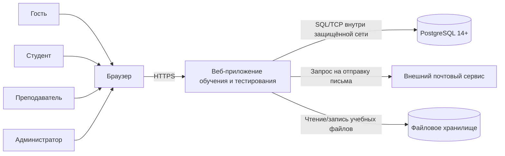
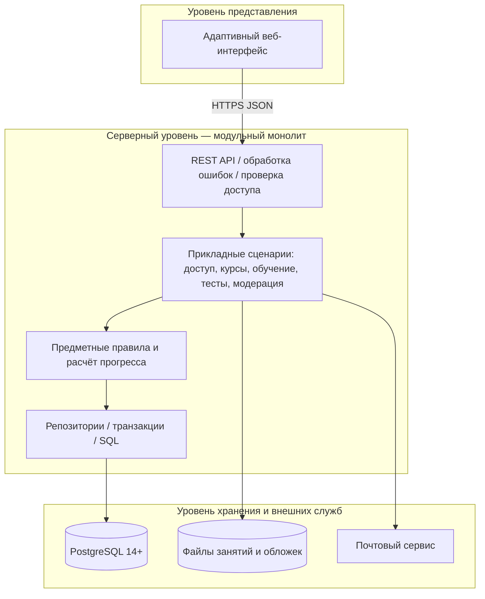
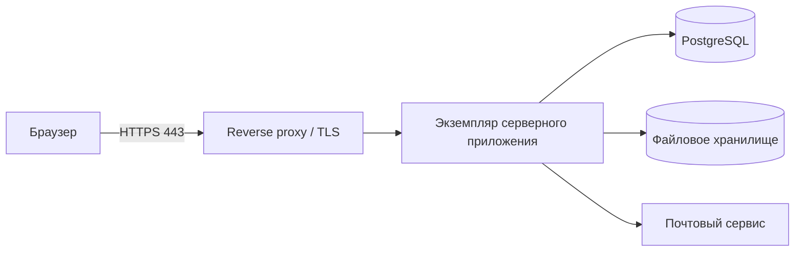

# Архитектура

## 1. Контекстная схема

Внешними для приложения являются браузеры пользователей, сервис отправки электронных писем и выбранное файловое хранилище. БД считается отдельным инфраструктурным узлом в пределах доверенного серверного контура.

## 2. Многоуровневая архитектура

### 2.1. Уровень представления

Отвечает за экраны из «Пользовательский интерфейс.md», переходы из «Навигация.md», отображение ошибок и адаптацию к устройствам. Никакие клиентские расчёты баллов и проверки ролей не считаются авторитетными.

### 2.2. Серверный уровень

- API принимает запросы, валидирует данные и формирует стандартные HTTP-ответы.
- Прикладные сервисы выполняют последовательности из «Сценарии.md».
- Предметный слой контролирует допустимые переходы состояний, принадлежность объектов, временной лимит теста и вычисление результата.
- Репозитории выполняют параметризованный SQL и обеспечивают транзакции.

### 2.3. Хранилища

**PostgreSQL 14+** — источник истины для пользователей, курсов, уроков, тестов, зачислений, результатов и решений модерации. Файловое хранилище держит учебные медиа; ссылка/путь может храниться в содержимом урока или соответствующих полях данных. Конкретный способ хранения пути должен быть согласован с фактической схемой БД; новые таблицы для файлов не вводятся без решения команды.

## 3. Развёртывание: минимальный и масштабируемый варианты

На первом этапе допускается один экземпляр сервера приложения и отдельный экземпляр PostgreSQL. Для масштабирования предполагается возможность нескольких **stateless** экземпляров API за балансировщиком с общими БД и файловым хранилищем. Состояние аутентификации должно проверяться на сервере; если применяются JWT, необходимы стратегия истечения срока и блокировки доступа при смене статуса `users.status`. Применение JWT отмечено в «Сценарии.md»; способ хранения/обновления токенов требует дополнительного решения, особенно для блокировки пользователя.

## 4. Основные данные и границы транзакций

- **Регистрация:** создание `users` и `email_activation_tokens` атомарно; отправка письма выполняется после подтверждения транзакции либо через надёжный механизм доставки. Повтор регистрации контролируется уникальностью email.
- **Активация:** проверка `token_hash`, срока и `used_at`, изменение `users.status` и пометка токена использованным — одна транзакция.
- **Зачисление:** проверка опубликованного статуса и роли студента; `UNIQUE(student_id, course_id)` защищает от дублей.
- **Завершение занятия:** `UNIQUE(enrollment_id, lesson_id)` и проверка принадлежности занятия тому же курсу, что и зачисление.
- **Завершение теста:** окончательное время рассчитывается на сервере; ответы, процент, статус попытки и обновление прогресса согласованы в одной прикладной операции.
- **Модерация:** изменение статуса курса и запись решения администратора образуют одну транзакцию.
- **Сертификат:** при включённом модуле однократность обеспечивается `UNIQUE(enrollment_id)`.

## 5. Нефункциональные требования и обеспечение

| Требование из документа НФТ | Архитектурный механизм и метод проверки |
|---|---|
| Каталог/карточка до 1,5 с при 100 одновременных запросах | Индексы, постраничная выборка, нагрузочный сценарий на опубликованный каталог |
| Страницы урока/теста до 1,0 с | Ограниченная загрузка данных, статические ресурсы отдельно; замер на браузере |
| Чтение API p95 ≤ 300 мс; запись p95 ≤ 500 мс | Индексы и транзакции, инструмент нагрузочного тестирования, раздельные метрики |
| 150 RPS в штатном режиме | Нагрузочное тестирование на целевом окружении; не заявляется как уже достигнутое |
| Доступность ≥ 99,5% | Мониторинг доступности, резервные копии, регламент восстановления; период измерения уточняется в НФТ |
| RTO ≤ 30 мин; RPO ≤ 24 ч | План восстановления и проверяемые резервные копии; требование RTO особенно зависит от инфраструктуры |
| HTTPS/TLS 1.2+, HSTS, CSP, X-Frame-Options | Настройка reverse proxy и заголовков, проверка сканером безопасности |
| Разделение ролей и безопасность | Серверная авторизация, пароли в стойких хешах, параметризованные SQL-запросы, защита от XSS/CSRF, ограничение попыток входа |
| Stateless API и рост до 10 000 пользователей / 500 курсов / 2 000 сессий | Минимизация серверного состояния, возможность горизонтального масштабирования; подтвердить нагрузочными испытаниями |
| Адаптивность и браузеры | Верстка и тестирование по НФТ (от 360 px, актуальные браузеры) |

## 6. Состояния доменных объектов

| Объект | Допустимые состояния | Основные переходы |
|---|---|---|
| `users` | `inactive`, `active`, `blocked` | регистрация → `inactive`; активация → `active`; блокировка → `blocked` |
| `courses` | `draft`, `pending`, `published` | создание → `draft`; отправка → `pending`; одобрение → `published`; отказ → `draft` |
| `enrollments` | `active`, `completed`, `withdrawn` | зачисление → `active`; завершение → `completed`; выход → `withdrawn` (если такой переход утверждён) |
| `test_attempts` | `in_progress`, `passed`, `failed` | старт → `in_progress`; завершение → `passed` либо `failed` |

Переходы не должны осуществляться произвольной заменой строк в БД; прикладная логика проверяет предыдущее состояние и права инициатора. В частности, возможность удаления/выхода из курса должна соответствовать фактическим Use Case, а не только значению `withdrawn` в таблице.

