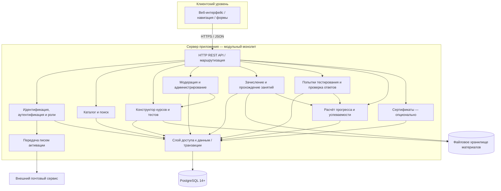

# Компонентная модель

## 1. Назначение и границы

Документ определяет **логические компоненты** веб-приложения для организации онлайн-обучения и тестирования.

Акторы: Гость, Студент, Преподаватель, Администратор; внешний участник — почтовый сервис. Сертификаты рассматриваются как опциональная подсистема согласно «Видение»; наличие таблицы `certificates` не означает обязательности включения функции в первую реализацию.

## 2. Диаграмма компонентов

## 3. Спецификация компонентов

| Компонент | Назначение и граница ответственности | Основные данные |
|---|---|---|
| Веб-интерфейс | Отображение каталога, личных кабинетов, форм, уроков и тестов; клиентская проверка форм и показ ошибок. Не является источником решений о правах или баллах | DTO из API; временное состояние UI |
| API / маршрутизация | Контракт запросов/ответов, сериализация, обработка ошибок, ограничения запросов, перенаправление к прикладным компонентам | Не владеет бизнес-данными |
| Аутентификация и роли | Регистрация, хеширование паролей, выпуск/проверка токенов активации, вход, профиль, блокировка и проверка ролей | `users`, `email_activation_tokens` |
| Каталог | Чтение опубликованных курсов, категорий, подробной программы; поиск и фильтры | `categories`, `courses`, `modules`, `lessons`, `tests` |
| Конструктор | Создание/изменение черновиков курсов, модулей, занятий, тестов, вопросов и вариантов | `courses`, `modules`, `lessons`, `tests`, `questions`, `answer_options` |
| Модерация | Просмотр очереди, подтверждение/отклонение публикации, сохранение решений, управление категориями и учетными записями | `courses`, `moderation_decisions`, `categories`, `users` |
| Обучение | Зачисление, просмотр доступных уроков, отметка завершения; защита от повторной записи | `enrollments`, `lesson_completions` |
| Тестирование | Начало и завершение попытки, фиксация ответов, таймер на сервере, оценивание, выдача результата | `tests`, `questions`, `answer_options`, `test_attempts`, `attempt_answers`, `attempt_answer_options` |
| Прогресс и успеваемость | Пересчёт достижений в рамках конкретного зачисления; таблица успеваемости автора курса | `enrollments`, `lesson_completions`, `test_attempts` |
| Сертификаты | При подтверждённом успешном завершении курса — однократная выдача и просмотр; отключаемый модуль | `certificates`, `enrollments` |
| Почтовый адаптер | Формирует заявку внешнему сервису на доставку письма; не выполняет проверку пароля | `email_activation_tokens`; почтовый сервис |
| Доступ к данным | Параметризованные запросы, управление транзакциями, обёртки над PostgreSQL | 16 таблиц по `01_create_database.sql` |

## 4. Контракты и зависимости

- **Клиент → API:** HTTPS; JSON для прикладных данных. Фронтенд не обращается к PostgreSQL напрямую.
- **API → компоненты:** передаёт идентификатор пользователя и доверенный контекст роли после серверной проверки; отсутствие права — отказ до изменения данных.
- **Компоненты → хранилище:** только через слой данных; конкурентные операции записи защищаются транзакциями и ограничениями `UNIQUE`/FK/`CHECK`.
- **Аутентификация → почта:** создаёт одноразовый токен, сохраняет только хеш и инициирует отправку; внешний почтовый сервис не имеет доступа к БД.
- **Тестирование → Прогресс:** успешная финализация попытки инициирует пересчёт прогресса; повторная финализация не должна повторно менять результат.
- **Модерация → Конструктор:** перевод `pending → published` при одобрении или `pending → draft` при отклонении, с записью решения в одной транзакции.

## 5. Разграничение доступа

| Действие | Гость | Студент | Преподаватель | Администратор |
|---|:---:|:---:|:---:|:---:|
| Просмотр опубликованного каталога и карточек | + | + | + | + |
| Регистрация и вход | + | — | — | — |
| Редактирование собственного профиля | — | + | + | + |
| Зачисление, отметка занятий, тесты | — | + | — | — |
| Создание и редактирование своих курсов | — | — | + | — |
| Просмотр успеваемости по своим курсам | — | — | + | — |
| Модерация, категории, блокировка пользователей | — | — | — | + |

Права зависят не только от роли, но и от владения объектом (`course.author_id`, `enrollment.student_id`). Администратор не получает автоматически право на редактирование учебных материалов преподавателя.

## 6. Соответствие компонентной модели артефактам

| Use Case | Ответственные компоненты |
|---|---|
| ВИ-1.1, ВИ-1.2, ВИ-1.3, ВИ-1.4 | Аутентификация, API, Почтовый адаптер |
| ВИ-2.1, ВИ-2.2 | Каталог |
| ВИ-2.3 | Обучение, Каталог |
| ВИ-3.1, ВИ-3.2 | Обучение, Прогресс |
| ВИ-3.3 | Тестирование, Прогресс |
| ВИ-3.4 | Сертификаты (опционально) |
| ВИ-4.1, ВИ-4.2, ВИ-4.3, ВИ-4.4 | Конструктор, Модерация |
| ВИ-4.5 | Прогресс и успеваемость |
| ВИ-5.1, ВИ-5.2, ВИ-5.3 | Модерация, Аутентификация |
