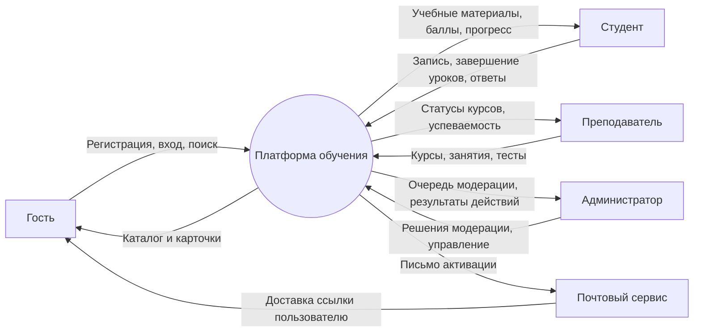
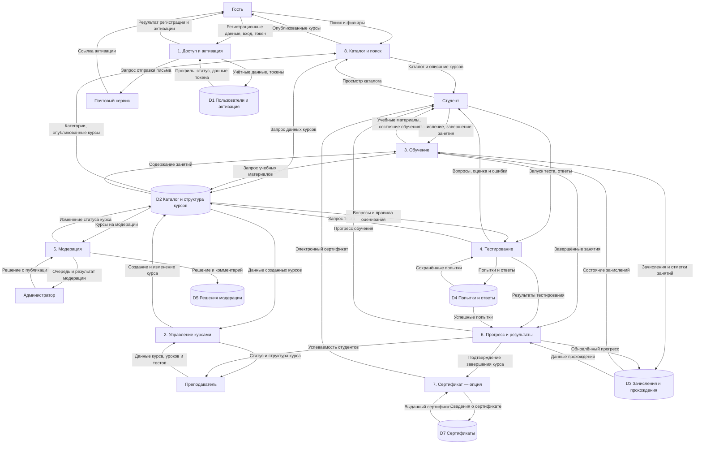
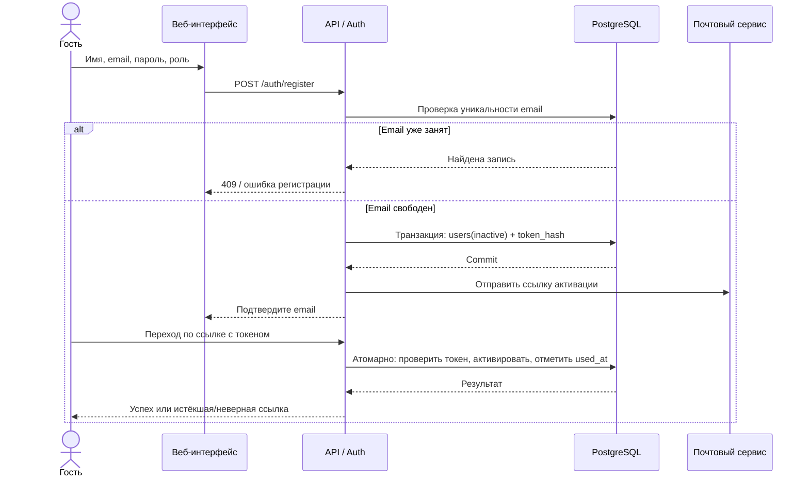
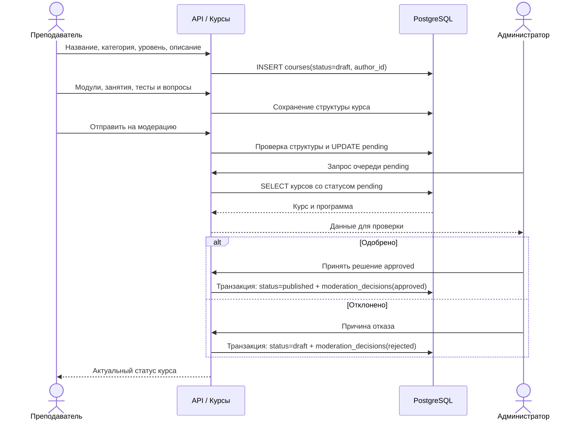
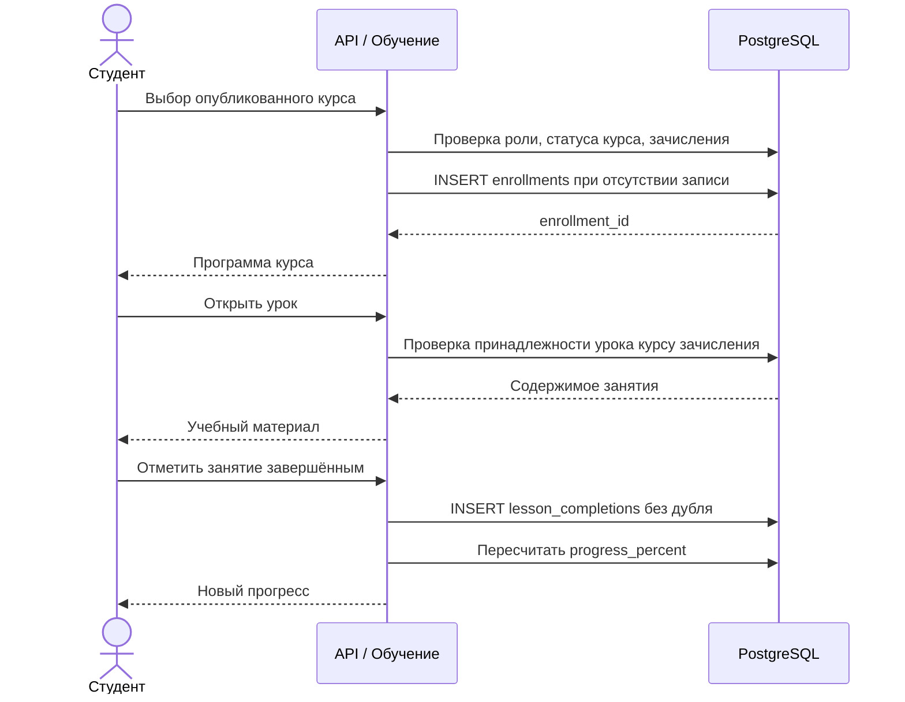
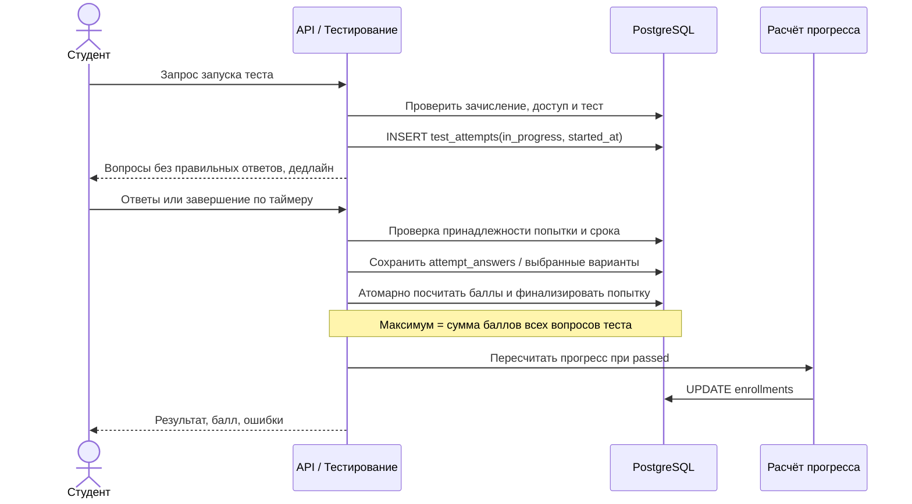
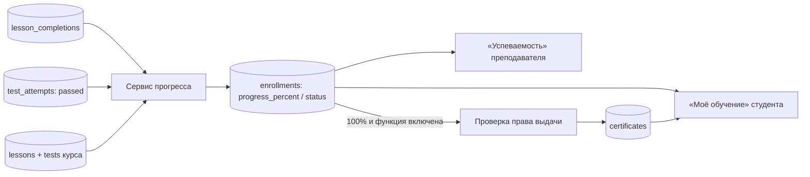

# Потоки данных

## 1. Назначение и обозначения

Документ описывает перемещение и преобразование данных между внешними участниками, серверными процессами и хранилищами веб-приложения обучения и тестирования. Диаграммы выполнены в Mermaid как DFD-подобные схемы потоков данных: прямоугольники — акторы и процессы; цилиндры — хранилища; подписанные стрелки — данные. Это не диаграммы физических сетевых пакетов и не схемы экранной навигации.

## 2. Контекстный поток (уровень 0)

## 3. Декомпозиция основных процессов (уровень 1)

На диаграмме показаны основные процессы платформы, внешние участники, хранилища данных и направления передачи информации. Стрелки обозначают передаваемые данные, а не последовательность выполнения операций.

| Хранилище | Соответствующие таблицы |
|---|---|
| D1 | `users`, `email_activation_tokens` |
| D2 | `categories`, `courses`, `modules`, `lessons`, `tests`, `questions`, `answer_options` |
| D3 | `enrollments`, `lesson_completions` |
| D4 | `test_attempts`, `attempt_answers`, `attempt_answer_options` |
| D5 | `moderation_decisions` |
| D7 | `certificates` |

Процесс 8 обеспечивает просмотр опубликованного каталога и поиск курсов. Процесс 6 объединяет сведения о завершённых занятиях и результатах тестирования для расчёта прогресса. Процесс 7 является опциональным и выполняется только при включённой функции выдачи сертификатов.

## 4. Поток F1: регистрация и активация (ВИ-1.1)

## 5. Поток F2: конструирование и публикация курса (ВИ-4.1–4.4, ВИ-5.1)

## 6. Поток F3: запись и завершение урока (ВИ-2.3, ВИ-3.2)

## 7. Поток F4: прохождение теста и вычисление результата (ВИ-3.3)

Правильные варианты ответов не должны передаваться на клиент до завершения попытки. Срок теста вычисляется по времени сервера (`started_at + time_limit_minutes`), а не только по клиентскому таймеру. Повторное завершение уже закрытой попытки отклоняется либо безопасно возвращает ранее сохранённый результат. Для `question_type='text'` правило автоматической оценки остаётся открытым вопросом.

## 8. Поток F5: успеваемость и сертификат (ВИ-4.5, ВИ-3.4)

Процент прогресса в проектной формуле — доля завершённых уроков и успешно сданных тестов среди всех элементов курса. При полном завершении `status` и значение `progress_percent` должны быть согласованы. Выдача сертификата — опциональна и должна защищаться уникальностью `certificates.enrollment_id`.

## 9. Контроль корректности потоков

| Поток | Позитивная проверка | Отрицательная проверка |
|---|---|---|
| F1 | Активированный пользователь может войти | Повторный email; истёкший и использованный токен |
| F2 | Одобренный курс отображается в каталоге | Студент не публикует курс; отказ без комментария |
| F3 | Зачисление и завершение урока изменяют прогресс | Двойное зачисление; урок чужого курса |
| F4 | Сервер оценивает ответы и сохраняет результат | Просроченная/чужая попытка; повторная финализация; пропущенный ответ |
| F5 | Преподаватель видит успеваемость своего курса | Попытка просмотра чужой ведомости; двойной сертификат |

## 10. Трассировка к базе данных и НФТ

- Для F1: `users`, `email_activation_tokens`; защищённое хранение паролей, TLS, журналирование событий.
- Для F2: `courses`, `modules`, `lessons`, `tests`, `questions`, `answer_options`, `moderation_decisions`; транзакционная целостность.
- Для F3: `enrollments`, `lesson_completions`; уникальность и согласованность процента.
- Для F4: `test_attempts`, `attempt_answers`, `attempt_answer_options`; ограничение времени и серверное оценивание.
- Для F5: `enrollments`, `certificates`; авторизация чтения и однократная выдача.
