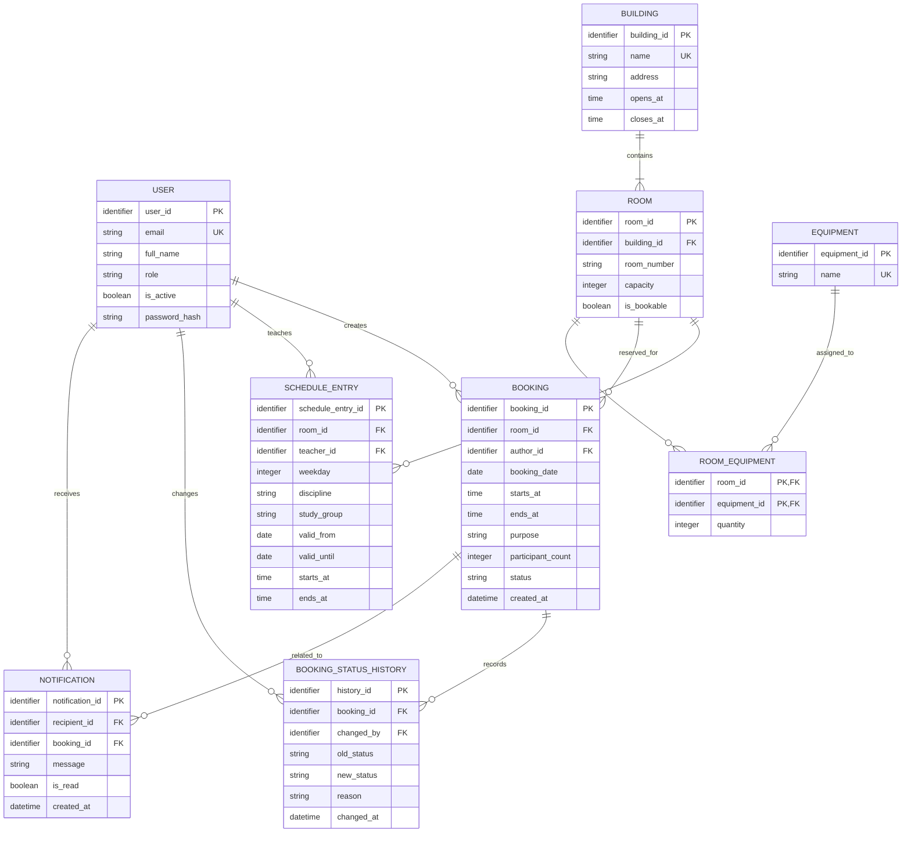

# Логическая схема базы данных RoomBook

Логическая модель описывает данные и связи без привязки к конкретной СУБД и физическому типу хранения. Названия и правила согласованы с [моделью предметной области](../03-Системный аналитик/Модель предметной области.md).

## ER-диаграмма

## Основные правила

- У пользователя уникальный адрес электронной почты; роль — студент, преподаватель или диспетчер.
- Статусы в хранилище: `pending` — «На рассмотрении», `confirmed` — «Подтверждено», `rejected` — «Отклонено», `cancelled` — «Отменено», `completed` — «Завершено».
- Корпус содержит аудитории. Номер аудитории уникален только внутри корпуса; вместимость положительна.
- Аудитория и оборудование связаны отношением многие-ко-многим. Для пары «аудитория — оборудование» хранится количество единиц.
- Запись основного расписания повторяется еженедельно в выбранный день недели в пределах периода действия.
- Время бронирования задаётся одной датой и интервалом `[начало, окончание)`. Соседние интервалы, например 10:00–11:00 и 11:00–12:00, не конфликтуют.
- Бронирование на рассмотрении не резервирует слот. Подтверждённое бронирование резервирует его и не должно пересекаться с другим подтверждённым бронированием или занятием основного расписания в той же аудитории.
- Перенос подтверждённой брони студента возвращает её на рассмотрение; новая запись истории фиксирует смену статуса.
- Каждое изменение статуса хранится отдельно с инициатором, временем и причиной (если она требуется бизнес-правилами).
- Уведомление принадлежит получателю и может ссылаться на связанную бронь.
