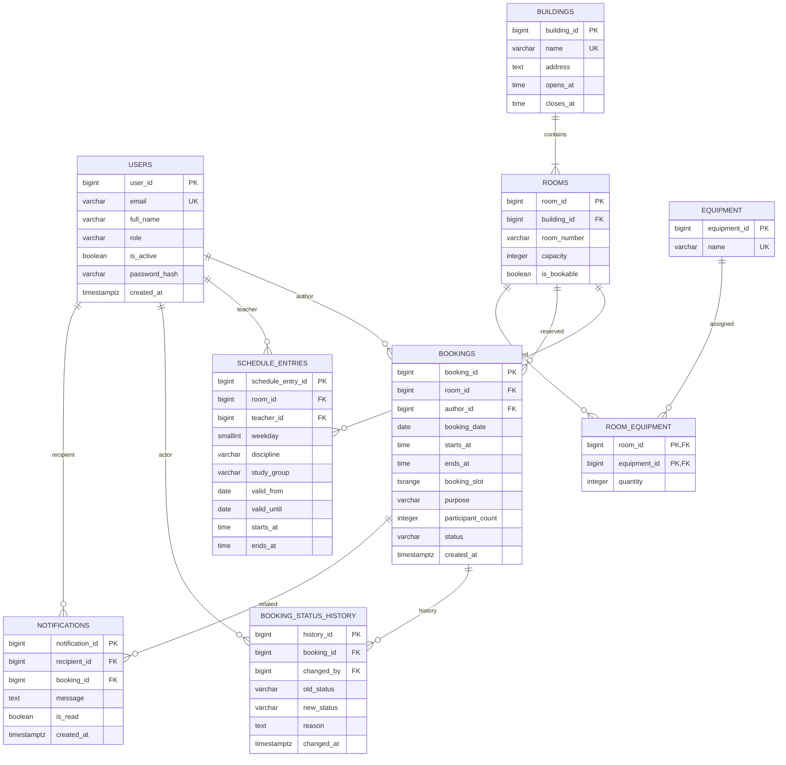

# Физическая схема базы данных RoomBook

Реализация: PostgreSQL 14+. Имена таблиц и полей — `snake_case`; первичные ключи — `GENERATED BY DEFAULT AS IDENTITY`. Внешние ключи используют `ON DELETE RESTRICT`, если отдельно не указано иное.

## Физическая ER-диаграмма

## Типы и ограничения

| Таблица | Физические поля и типы | Ограничения |
|---|---|---|
| `users` | `user_id bigint`, `email varchar(320)`, `full_name varchar(200)`, `role varchar(20)`, `is_active boolean`, `password_hash varchar(255)`, `created_at timestamptz` | `email` обязателен; уникальный индекс на `lower(email)`; `role IN ('student','teacher','dispatcher')`. |
| `buildings` | `building_id bigint`, `name varchar(120)`, `address text`, `opens_at time`, `closes_at time` | Уникальное имя; `opens_at < closes_at`. |
| `rooms` | `room_id bigint`, `building_id bigint`, `room_number varchar(30)`, `capacity integer`, `is_bookable boolean` | FK на корпус; `UNIQUE(building_id, room_number)`; `capacity > 0`. |
| `equipment` | `equipment_id bigint`, `name varchar(100)` | Уникальное непустое имя. |
| `room_equipment` | `room_id bigint`, `equipment_id bigint`, `quantity integer` | Составной PK; оба FK; `quantity > 0`. |
| `schedule_entries` | `schedule_entry_id bigint`, `room_id bigint`, `teacher_id bigint`, `weekday smallint`, `discipline varchar(200)`, `study_group varchar(80)`, `valid_from date`, `valid_until date`, `starts_at time`, `ends_at time` | ISO-день 1–7; `valid_from <= valid_until`; `starts_at < ends_at`; FK на аудиторию и преподавателя. |
| `bookings` | `booking_id bigint`, `room_id bigint`, `author_id bigint`, `booking_date date`, `starts_at time`, `ends_at time`, `booking_slot tsrange` (вычисляемое), `purpose varchar(500)`, `participant_count integer`, `status varchar(24)`, `created_at timestamptz` | Проверки интервала, числа участников и статуса; FK; исключение пересечения диапазонов для `confirmed`; триггер проверяет вместимость, часы работы и основное расписание. |
| `booking_status_history` | `history_id bigint`, `booking_id bigint`, `changed_by bigint`, `old_status varchar(24)`, `new_status varchar(24)`, `reason text`, `changed_at timestamptz` | FK на бронь и пользователя; статусы соответствуют допустимым значениям. |
| `notifications` | `notification_id bigint`, `recipient_id bigint`, `booking_id bigint NULL`, `message text`, `is_read boolean`, `created_at timestamptz` | FK на пользователя и необязательная FK на бронь. |

## Индексы и особые решения

- Для `bookings` используется расширение PostgreSQL `btree_gist`: исключающее ограничение по `room_id` и вычисляемому `booking_slot` запрещает перекрытие подтверждённых броней.
- Поле `booking_slot` хранит диапазон timestamp без часового пояса (`tsrange`) из даты и локального времени университета; интервал полуоткрытый `[начало, окончание)`.
- Частичный GiST-индекс/ограничение действует только при `status = 'confirmed'`; заявки студентов в статусе `pending` допускают одновременное рассмотрение и сами слот не занимают.
- Для расписания добавлен индекс `(room_id, weekday, valid_from, valid_until)`. Для пользовательского списка — `(author_id, created_at DESC)`. Для уведомлений — `(recipient_id, is_read, created_at DESC)`. Для истории — `(booking_id, changed_at)`.
- Проверку конфликта с повторяющимся расписанием выполняет триггер, поскольку занятие определяется также днём недели и диапазоном дат действия.
