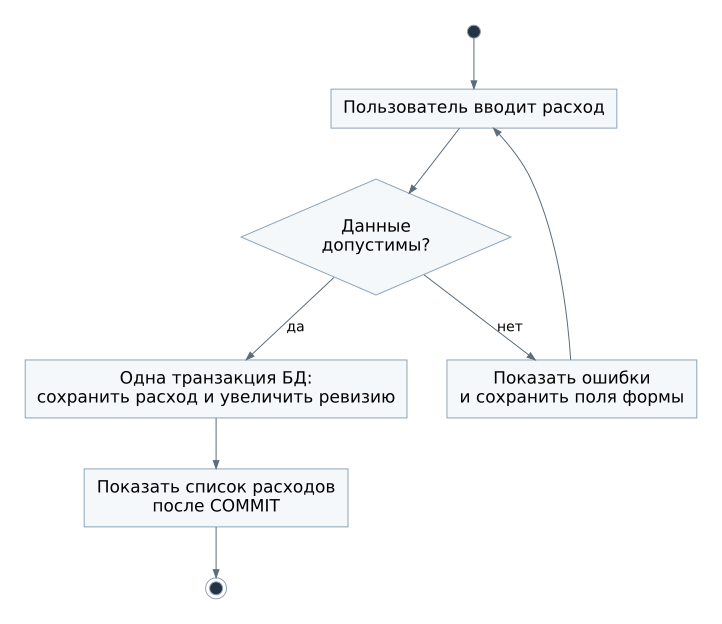

# Бизнес-процессы

## Участники и границы

Гость создаёт учётную запись или входит в существующую. Пользователь работает только со своими расходами и категориями. Сервис проверяет данные, сохраняет изменения и рассчитывает сводки. Работа администратора сервера не относится к пользовательским бизнес-процессам.

## БП-01. Начало работы

**Событие:** человек впервые открывает сервис. **Результат:** создана учётная запись, пользователь может начать учёт.

1. Гость открывает регистрацию и вводит логин, пароль и подтверждение пароля.
2. Сервис проверяет уникальность логина, совпадение паролей и правила сложности.
3. Сервис в одной транзакции создаёт пользователя, запись ревизии и две начальные категории.
4. После успешного сохранения гость переходит на страницу входа.
5. Пользователь входит и видит пустой список расходов с кнопкой добавления.

Если логин занят или данные неверны, сервис показывает ошибку у поля. Учётная запись частично не создаётся. При ошибке БД регистрация отменяется целиком.

## БП-02. Учёт расхода

**Событие:** пользователь хочет записать трату или исправить запись. **Результат:** список и последующие сводки соответствуют сохранённым расходам.

1. Пользователь открывает форму нового расхода или выбирает существующую запись.
2. Вводит сумму, дату, категорию и при необходимости комментарий.
3. Сервис проверяет сумму и дату, принадлежность категории и право изменять запись.
4. Если ошибок нет, сервис сохраняет расход и увеличивает ревизию данных пользователя в одной транзакции.
5. После фиксации транзакции пользователь возвращается к списку с прежними фильтрами.

При ошибке формы введённые значения сохраняются. При отказе БД расход не считается сохранённым. Повторное нажатие кнопки на время отправки блокируется в интерфейсе, но полная защита от повторной отправки одного и того же нового расхода не входит в первую версию.

Удаление начинается с подтверждения, где показаны дата, сумма и категория. При отказе от подтверждения ничего не меняется. При подтверждении удаляются запись и её участие в будущих сводках. Ревизия меняется вместе с удалением.

## БП-03. Просмотр месячной сводки

**Событие:** пользователь выбирает месяц. **Результат:** получена общая сумма и распределение расходов по категориям.

1. Пользователь открывает «Сводку» и выбирает календарный месяц.
2. Сервис определяет владельца по сессии и границы месяца.
3. Сервис получает сводку для этого пользователя и месяца.
4. Пользователь видит итог, суммы категорий и их доли. Для месяца без расходов показываются нулевой итог и сообщение об отсутствии записей.

Использование кэша не меняет смысл процесса. При его недоступности сервис обращается к основной БД. При недоступной основной БД сервис показывает ошибку загрузки, а не нулевые расходы.

Доля категории равна её сумме, делённой на общую сумму, и умноженной на 100%. На экране доли округляются до одного знака после запятой, поэтому сумма отображаемых долей может не совпасть ровно со 100%. Денежные итоги рассчитываются без округления до показа.

## БП-04. Ведение категорий

**Событие:** текущих категорий недостаточно или одна больше не используется. **Результат:** справочник соответствует способу учёта пользователя, история расходов сохранена.

1. Пользователь открывает «Категории».
2. Создаёт новую категорию, переименовывает существующую, архивирует её или восстанавливает.
3. Сервис проверяет права, длину и уникальность названия.
4. Изменение категории и увеличение ревизии фиксируются вместе.

Архивирование не удаляет расходы. Переименование меняет подпись категории и у старых записей. Удаление допускается только при отсутствии связанных расходов. Для категории с историей сервис предлагает архивирование.

## Связь с требованиями

| Процесс | Пользовательские истории | Варианты использования |
| --- | --- | --- |
| БП-01 | US-01, US-02 | UC-01, UC-02, UC-03 |
| БП-02 | US-03, US-04, US-05, US-06 | UC-04, UC-05, UC-06, UC-07 |
| БП-03 | US-10, US-11 | UC-12 |
| БП-04 | US-07, US-08, US-09 | UC-08, UC-09, UC-10, UC-11 |

