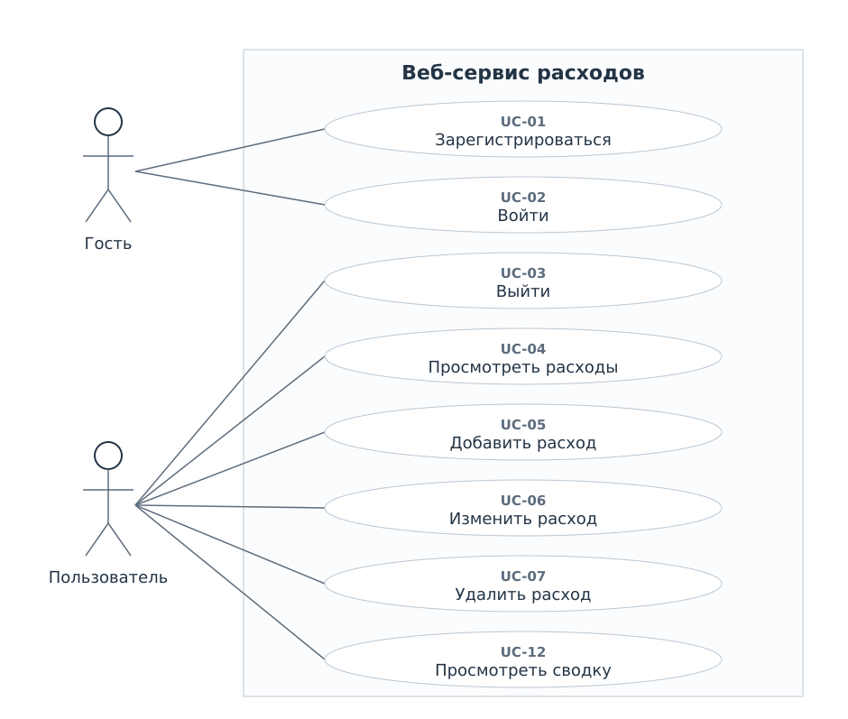
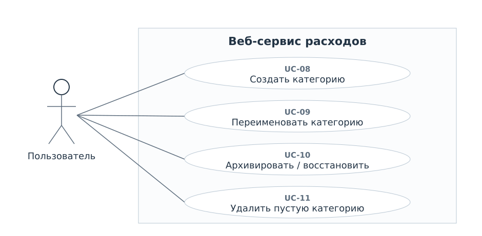

# Варианты использования

Гость работает с регистрацией и входом. Пользователь имеет действующую сессию. Для всех его операций, кроме выхода, сервер определяет владельца по сессии. Успешный вход является предусловием закрытых операций, а не повторяемым шагом каждой из них.

| ID | Вариант | Актор | Предусловие | Результат |
| --- | --- | --- | --- | --- |
| UC-01 | Зарегистрироваться | Гость | Нет действующей сессии | Созданы аккаунт, ревизия и начальные категории |
| UC-02 | Войти | Гость | Аккаунт существует и активен | Создана сессия, открыт список расходов |
| UC-03 | Выйти | Пользователь | Есть сессия | Сессия завершена |
| UC-04 | Просмотреть и отфильтровать расходы | Пользователь | Есть сессия | Показаны свои записи за период и по категории |
| UC-05 | Добавить расход | Пользователь | Есть хотя бы одна активная категория | Запись сохранена, ревизия увеличена |
| UC-06 | Изменить расход | Пользователь | Свой расход существует | Запись изменена, ревизия увеличена |
| UC-07 | Удалить расход | Пользователь | Свой расход существует | После подтверждения запись удалена |
| UC-08 | Создать категорию | Пользователь | Есть сессия | Новая активная категория принадлежит пользователю |
| UC-09 | Переименовать категорию | Пользователь | Своя категория существует | Новое название видно в истории и сводках |
| UC-10 | Архивировать или восстановить категорию | Пользователь | Своя категория существует | Признак архива изменён |
| UC-11 | Удалить пустую категорию | Пользователь | У своей категории нет расходов | Категория удалена после подтверждения |
| UC-12 | Просмотреть месячную сводку | Пользователь | Есть сессия, месяц допустим | Показаны итог и распределение по категориям |

## Ошибки доступа

При отсутствии сессии закрытая страница направляет на вход. Обращение к чужому или отсутствующему расходу либо категории возвращает 404 без раскрытия владельца. Проверка действует и для запросов изменения. Параметры фильтра не дают доступа к чужим данным.

## Подтверждения и отказы

Подтверждение нужно только для удаления. Архивирование обратимо и выполняется отдельной командой. Если в системе нет активных категорий, форма добавления расхода предлагает создать категорию или восстановить архивную, сохраняя уже введённые значения при возврате в форму в пределах открытой страницы.

