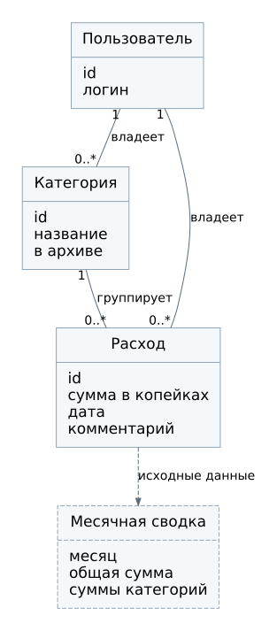

# Модель предметной области

## Объекты и связи

| Объект | Существенные свойства | Связи |
| --- | --- | --- |
| Пользователь | Идентификатор, логин | Имеет от 0 до многих категорий и расходов |
| Категория | Идентификатор, название, признак архива | Принадлежит одному пользователю; объединяет от 0 до многих расходов |
| Расход | Идентификатор, сумма в копейках, дата, комментарий | Принадлежит одному пользователю и одной категории |
| Месячная сводка | Месяц, итог, строки категорий | Рассчитывается для одного пользователя; не является самостоятельной исходной записью |

Сводка является производным объектом. Она может временно храниться в Redis, но её исходные данные находятся в расходах и категориях PostgreSQL. Сессия и ревизия относятся к технической модели и показаны в схемах БД.

## Инварианты

- Владелец расхода совпадает с владельцем категории.
- Сумма хранится целым числом копеек и строго больше нуля.
- Дата расхода обозначает календарную дату, а не момент времени. Перевод часового пояса её не меняет.
- Названия категорий уникальны у пользователя без учёта регистра.
- Архивирование категории не меняет принадлежность старых расходов.
- Переименование категории применяется ко всем связанным расходам, в том числе старым.
- Категорию с расходами нельзя удалить.
- Итог месяца равен сумме всех его расходов и сумме строк категорий.

## Расчёт сводки

Для пользователя `u` и месяца `m` выбираются его расходы, у которых дата не раньше начала `m` и строго раньше начала следующего месяца. Общий итог `T` равен сумме `amount_minor` выбранных записей. Для каждой категории рассчитывается сумма `S` и доля `100 × S / T`, если `T > 0`.

При отсутствии записей итог равен нулю, список категорий пуст. Категории без расходов в выбранном месяце не создают нулевые строки. Архивные категории с расходами участвуют в расчёте на общих основаниях.

