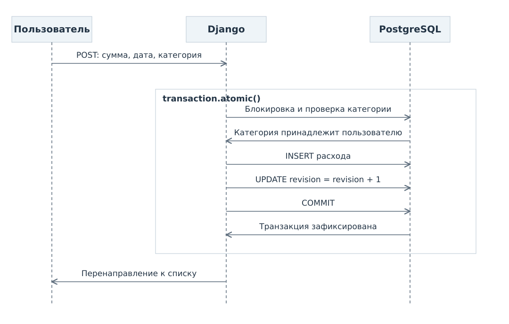

# Сценарии использования

## UC-01. Регистрация

Гость открывает форму, вводит свободный логин, пароль и подтверждение. Сервер проверяет значения и в одной транзакции создаёт пользователя, ревизию `0`, категории «Продукты» и «Транспорт». После фиксации открывается страница входа с сообщением об успешной регистрации.

**Альтернативы:** занятый логин, несовпадение паролей или ошибка валидатора оставляют форму с сообщением у поля. Пароль не возвращается в HTML. При ошибке БД вся транзакция откатывается.

## UC-02 и UC-03. Вход и выход

1. Гость вводит логин и пароль.
2. Сервер проверяет активность аккаунта и пароль средствами Django.
3. После успешной проверки создаётся сессия, пользователь попадает в список расходов.
4. Кнопка «Выйти» отправляет POST с CSRF-токеном. Сессия прекращается, открывается вход.

**Альтернативы:** неверный логин, пароль или неактивный аккаунт дают одно сообщение «Неверный логин или пароль». Истёкшая сессия требует повторного входа. Повторять запрос изменения после входа автоматически нельзя: пользователь проверяет форму и отправляет её заново.

## UC-04. Список расходов

По умолчанию открываются расходы текущего календарного месяца. Пользователь задаёт даты «с» и «по», категорию либо сбрасывает фильтры к текущему месяцу и всем категориям. Сервер проверяет границы, ограничивает выборку текущим пользователем и применяет фильтры совместно. Оба конца диапазона включаются. Порядок: дата по убыванию, затем идентификатор по убыванию. На странице 20 записей.

**Альтернативы:** начальная дата позже конечной даёт ошибку фильтра. Пустая выборка показывает «Расходов за выбранный период нет». Архивная категория доступна в фильтре истории. Чужой идентификатор категории не даёт расширить доступ.

## UC-05. Добавление расхода

1. Пользователь открывает форму. По умолчанию указана текущая дата.
2. Вводит `80,00`, выбирает активную категорию «Продукты», дату и необязательный комментарий.
3. Сервер повторно проверяет поля и принадлежность категории.
4. В `transaction.atomic()` блокирует выбранную категорию, снова проверяет её состояние, создаёт расход на 8 000 копеек и увеличивает ревизию пользователя через SQL-выражение `revision + 1`.
5. После COMMIT выполняется перенаправление к списку. Следующий запрос сводки использует новую ревизию.

**Альтернативы:** ошибка поля сохраняет остальные введённые значения. Категория, успевшая стать архивной, требует выбрать другую. Ошибка БД отменяет обе записи. Недоступность Redis не мешает сохранению, потому что операция записи в основной БД от Redis не зависит.

## UC-06. Изменение расхода

Сервер получает расход по паре «идентификатор, текущий пользователь». Форма содержит его данные. Пользователь меняет значения. Проверки и транзакция совпадают с UC-05, но обновляется существующая запись. Если запись уже связана с архивной категорией, её можно оставить; выбрать другую архивную категорию нельзя.

При изменении даты с октября на ноябрь ревизия увеличивается один раз для пользователя. Поэтому следующие запросы обоих месяцев не используют старые ключи. Одновременное редактирование в двух вкладках разрешается последним успешным сохранением; обнаружение конфликтов форм в первую версию не входит.

## UC-07. Удаление расхода

Пользователь выбирает удаление. Страница подтверждения показывает дату, категорию и сумму. Отмена возвращает к списку без изменений. Подтверждение отправляет POST. Сервер снова проверяет владельца, удаляет запись и увеличивает ревизию в одной транзакции. Повторное удаление уже отсутствующей записи возвращает 404.

## UC-08 и UC-09. Название категории

Пользователь вводит название новой или существующей категории. Сервер удаляет пробелы по краям, проверяет длину и уникальность без учёта регистра. В транзакции создаёт или переименовывает категорию и увеличивает ревизию. Конфликт уникальности, в том числе при одновременных запросах, возвращается как ошибка формы.

## UC-10. Архивирование и восстановление

Пользователь нажимает «В архив» или «Восстановить». Сервер проверяет владельца и меняет `is_archived` вместе с ревизией. Расходы не удаляются. Архивирование всех категорий допустимо; для следующего нового расхода потребуется создать или восстановить хотя бы одну.

## UC-11. Удаление категории

После подтверждения сервер проверяет отсутствие расходов и пытается удалить категорию в транзакции с увеличением ревизии. Внешний ключ БД не позволяет удалить категорию, если расход появился одновременно. Тогда сервис сообщает «В категории есть расходы. Её можно отправить в архив». Изменения транзакции отменяются.

## UC-12. Сводка за месяц

1. Пользователь выбирает `2026-10`.
2. Сервер проверяет месяц и получает ревизию текущего пользователя из PostgreSQL.
3. Формирует ключ вида `expenses:v1:u:1:r:4:m:2026-10` и запрашивает Redis.
4. При пригодном значении возвращает его. При отсутствии, неправильном формате или ошибке Redis рассчитывает суммы по PostgreSQL.
5. После расчёта повторно читает ревизию. Если она не изменилась и Redis доступен, сохраняет JSON с TTL 60 секунд.
6. Показывает сумму и распределение. Для примера итог составляет 720,00 рубля, «Продукты» 630,00, «Транспорт» 90,00.

**Конкурентное изменение:** если ревизия успела смениться, результат этого запроса не записывается в кэш. Уже выполняющийся запрос может отобразить состояние до параллельного сохранения. Новый запрос, начавшийся после успешного COMMIT, читает новую ревизию.

**Отказы:** недоступный Redis означает расчёт по БД. Недоступная PostgreSQL означает ошибку загрузки сводки, потому что нельзя проверить текущую ревизию. Нулевой итог в этом случае не показывается.

