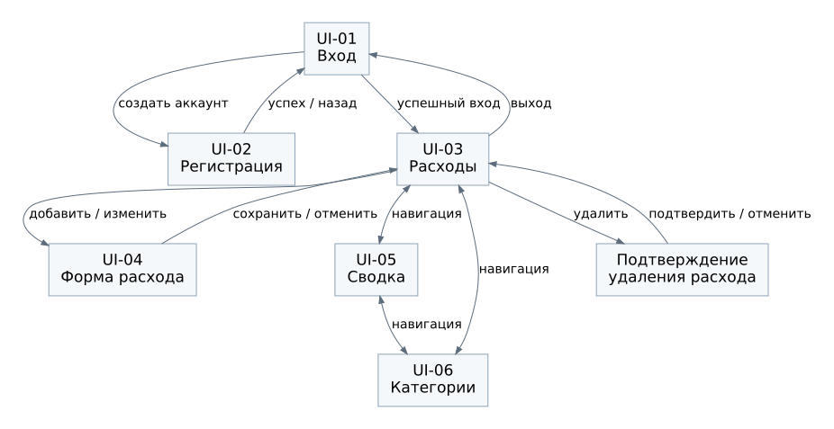

# Навигация

## Маршруты

| Маршрут | Метод | Экран или действие | Доступ |
| --- | --- | --- | --- |
| `/accounts/register/` | GET, POST | UI-02, регистрация | Гость |
| `/accounts/login/` | GET, POST | UI-01, вход | Гость |
| `/accounts/logout/` | POST | Завершение сессии и переход на вход | Пользователь |
| `/expenses/` | GET | UI-03, список, фильтры и страницы | Пользователь |
| `/expenses/new/` | GET, POST | UI-04, новый расход | Пользователь |
| `/expenses/<id>/edit/` | GET, POST | UI-04, изменение своего расхода | Пользователь |
| `/expenses/<id>/delete/` | GET, POST | Подтверждение и удаление своего расхода | Пользователь |
| `/summary/` | GET | UI-05, месячная сводка | Пользователь |
| `/categories/` | GET | UI-06, список категорий | Пользователь |
| `/categories/new/` | POST | Создание категории из формы UI-06 | Пользователь |
| `/categories/<id>/edit/` | GET, POST | Форма переименования | Пользователь |
| `/categories/<id>/archive/` | POST | Архивирование | Пользователь |
| `/categories/<id>/restore/` | POST | Восстановление | Пользователь |
| `/categories/<id>/delete/` | GET, POST | Подтверждение и удаление пустой категории | Пользователь |

GET не изменяет состояние. Все POST требуют CSRF-токен. Корневой маршрут `/` направляет гостя на вход, пользователя в список расходов.

## Переходы

- Регистрация после успеха ведёт на вход. Вход ведёт к расходам.
- Основная навигация доступна на всех закрытых экранах. Активный раздел выделен текстом и подчёркиванием.
- «Добавить расход» открывает пустую форму, «Изменить» открывает заполненную.
- Успешное сохранение, удаление или отмена возвращают к списку с прежними фильтрами и номером страницы. Если последняя страница после удаления исчезла, открывается ближайшая существующая.
- После действий с категорией открывается список категорий. Формы переименования и удаления имеют явную кнопку отмены.
- Кнопка выхода завершает сессию и открывает вход. Повторное открытие закрытой страницы требует аутентификации.

Фильтры расходов передаются параметрами `date_from`, `date_to`, `category`, `page`. Месяц сводки передаётся как `month=2026-10`. Параметры проверяются сервером, идентификатор пользователя в URL не передаётся. Адрес возврата может указывать только на разрешённый внутренний маршрут.

