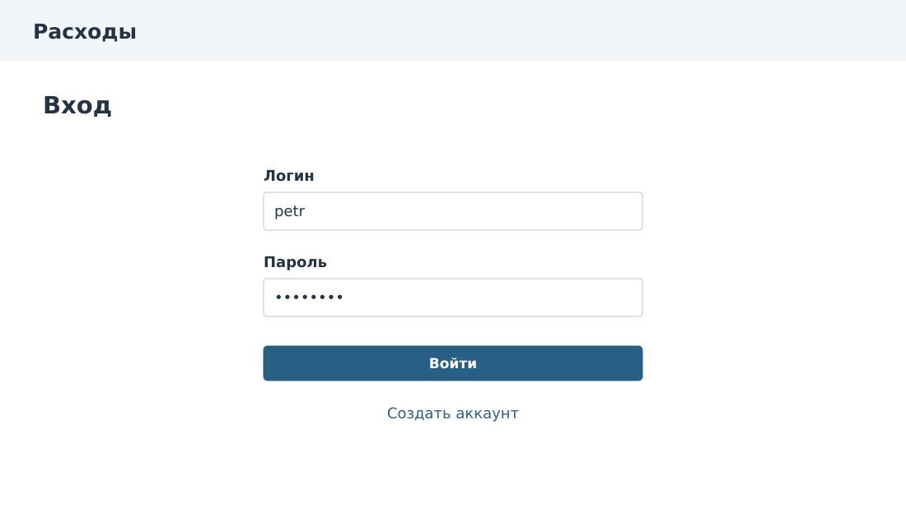
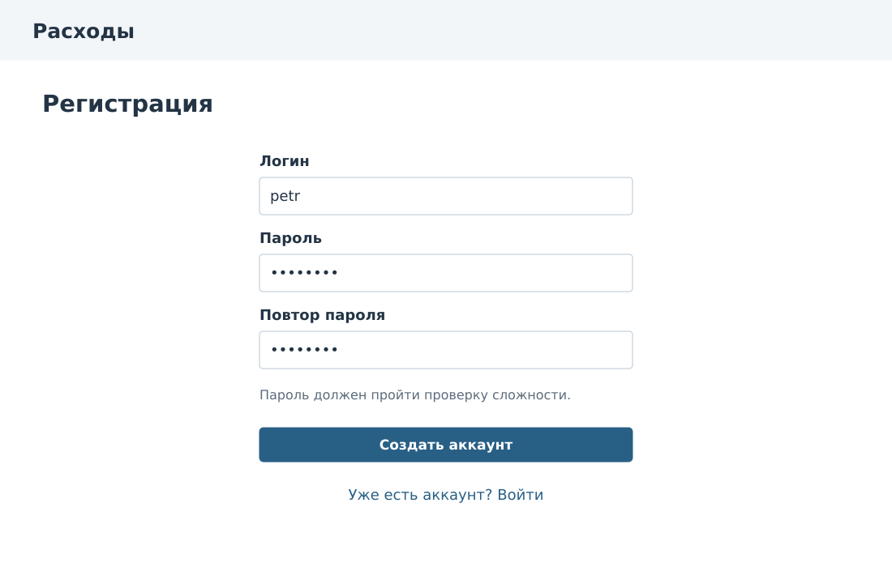
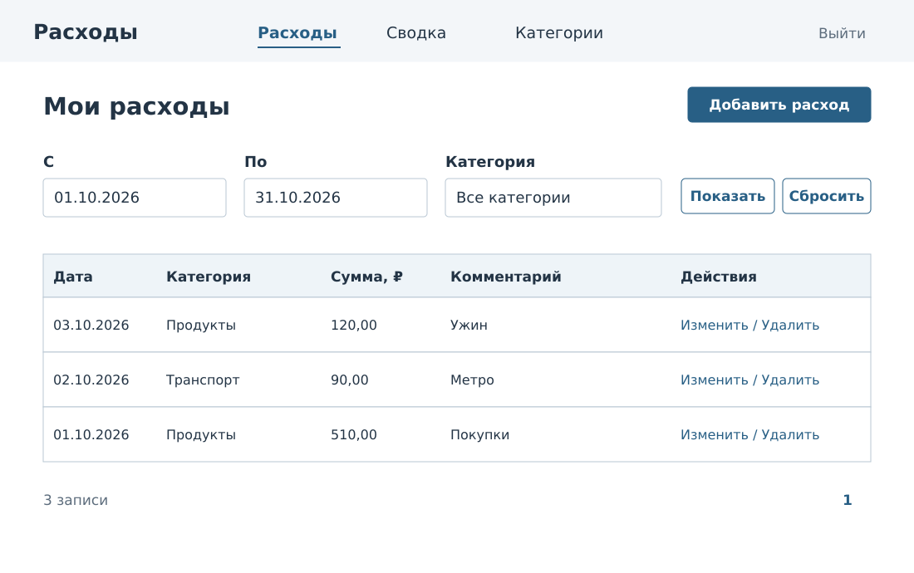
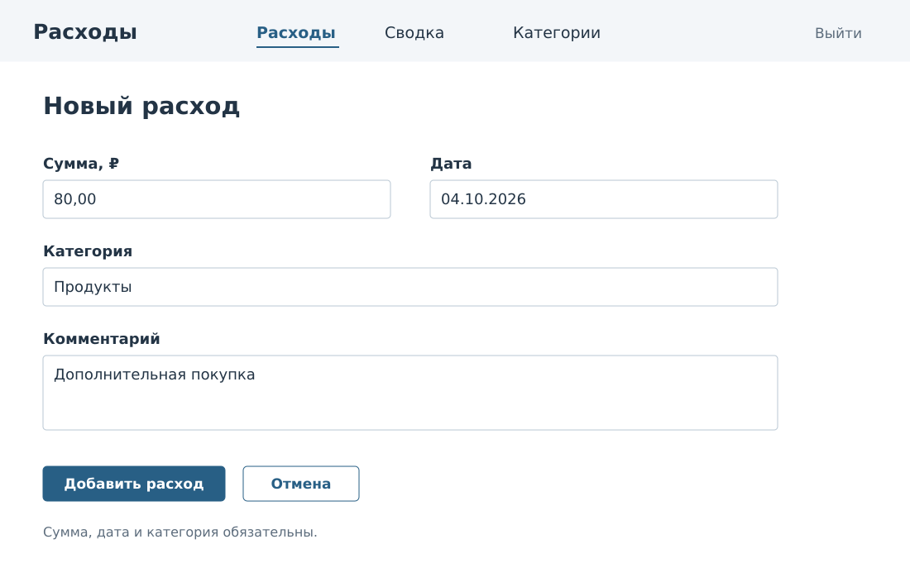
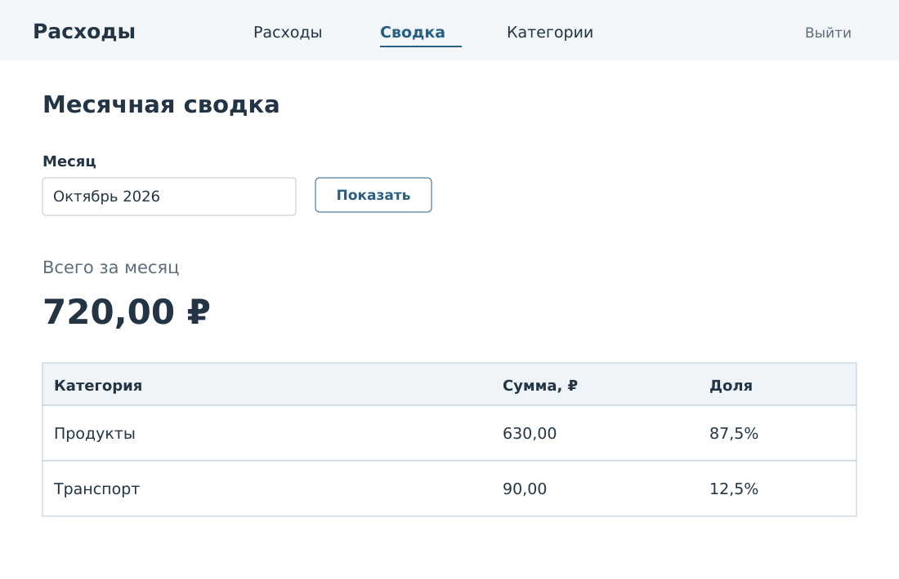
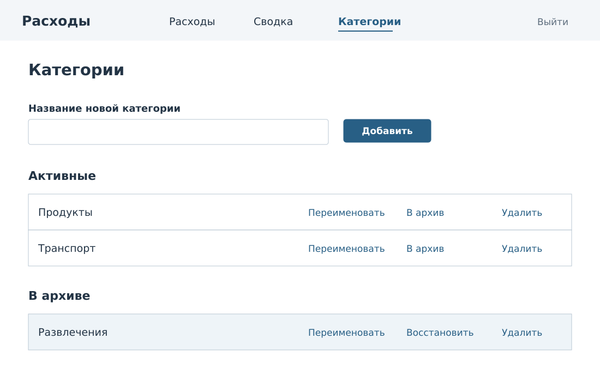

# Пользовательский интерфейс

Макеты показывают первую версию сервиса. Данные на экранах соответствуют проверочному набору: октябрь 2026 года, итог 720,00 рубля.

## Экраны

| ID | Экран | Сценарии |
| --- | --- | --- |
| UI-01 | Вход | UC-02 |
| UI-02 | Регистрация | UC-01 |
| UI-03 | Расходы | UC-04, UC-07 |
| UI-04 | Добавление и изменение расхода | UC-05, UC-06 |
| UI-05 | Сводка | UC-12 |
| UI-06 | Категории | UC-08, UC-09, UC-10, UC-11 |

## UI-01. Вход

Поля: логин, пароль. Основная кнопка «Войти», ссылка «Создать аккаунт». Ошибка входа общая: «Неверный логин или пароль». Логин сохраняется, пароль очищается. После входа открывается список расходов.

## UI-02. Регистрация

Поля: логин, пароль, повтор пароля. Правила пароля показывает форма согласно настроенным валидаторам Django. Ошибки логина и подтверждения размещаются у полей. После успешной регистрации открывается вход, а не отдельная страница профиля.

## UI-03. Расходы

Верхняя навигация: «Расходы», «Сводка», «Категории», «Выйти». Основная кнопка «Добавить расход». Фильтры: даты «с» и «по», категория, кнопки «Показать» и «Сбросить». В списке показаны дата, категория, сумма, комментарий и действия.

По умолчанию выбран текущий месяц. Кнопка «Сбросить» возвращает этот период и выбор всех категорий. Порядок записей: новые даты сверху, при равных датах больший идентификатор сверху. Пагинация по 20 записей сохраняет фильтры. На экране 360–767 px каждая запись показана карточкой с теми же полями, фильтры располагаются в столбец.

Удаление открывает подтверждение: «Удалить расход 120,00 ₽, Продукты, 03.10.2026?» с кнопками «Удалить» и «Отмена». Вторая кнопка ничего не изменяет.

## UI-04. Форма расхода

Обязательны сумма, дата и категория. Комментарий необязателен, до 255 символов. Сумма вводится в рублях, подсказка: «Например, 80,00». У новой записи по умолчанию сегодняшняя дата. При изменении форма заполнена текущими данными, заголовок и основная кнопка меняются на «Изменение расхода» и «Сохранить».

В выборе новой категории видны только активные. При редактировании можно оставить прежнюю архивную категорию, помеченную «в архиве». Если активных категорий нет, форма предлагает перейти к их созданию или восстановлению. Для возврата без потери данных переход открывает категории в новой вкладке; после возврата выбор категории обновляется кнопкой «Обновить список».

Примеры ошибок: «Укажите сумму от 0,01 до 999 999 999,99», «Допустимо не более двух знаков после запятой», «Выберите активную категорию», «Укажите существующую дату». Ошибка БД показывается над формой и не сопровождается сообщением об успехе.

## UI-05. Месячная сводка

Выбор месяца, общий итог, таблица категорий с суммами и долями. Для примера: «Продукты» 630,00 ₽ и 87,5%, «Транспорт» 90,00 ₽ и 12,5%. Итог 720,00 ₽.

При отсутствии расходов показаны 0,00 ₽ и ссылка «Добавить расход». При ошибке загрузки выводится «Не удалось загрузить сводку» и кнопка повтора. Сообщения о попадании в Redis и технические ключи в пользовательский интерфейс не входят.

## UI-06. Категории

Поле названия и кнопка «Добавить». Для активной категории доступны «Переименовать», «В архив» и «Удалить». У архивной доступны «Переименовать», «Восстановить» и «Удалить». Архивные записи видны в отдельном блоке этой же страницы.

Категория «Развлечения» на макете иллюстрирует архивное состояние. Расходов в ней нет, поэтому она не меняет контрольную сумму 720,00 рубля.

При переименовании открывается форма с текущим названием. При удалении появляется подтверждение. Если есть расходы, вместо удаления показывается сообщение «В категории есть расходы. Её можно отправить в архив».

## Общие состояния

| Состояние | Поведение |
| --- | --- |
| Отправка формы | Основная кнопка временно недоступна, текст «Сохранение…» |
| Неверное поле | Сообщение у поля и сохранение остальных данных |
| Нет данных | Объяснение пустого состояния и переход к первому действию |
| Истекла сессия | Переход на вход, без автоматического повтора изменения |
| Нет права доступа | Страница 404 без информации о чужом объекте |
| Успешное изменение | Перенаправление к списку и краткое сообщение о результате |

Все поля имеют подписи, порядок обхода клавиатурой совпадает с порядком на экране, фокус виден. Цвет не является единственным способом сообщить ошибку или архивный статус.

