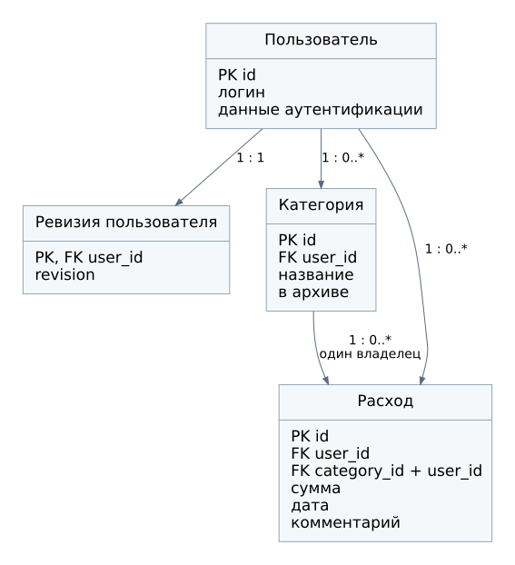

# Логическая схема БД

## Отношения

| Отношение | Ключ | Атрибуты и связи |
| --- | --- | --- |
| Пользователь | `id` | Уникальный логин, хэш пароля и служебные поля аутентификации |
| Ревизия пользователя | `user_id`, одновременно FK | Один счётчик `revision` на пользователя |
| Категория | `id` | `user_id`, название, признак архива |
| Расход | `id` | `user_id`, `category_id`, сумма в копейках, дата, комментарий, время создания и изменения |
| Сессия Django | `session_key` | Закодированные данные сессии и срок действия |

У пользователя может быть много категорий и расходов. Каждая категория и каждый расход имеют одного владельца. У расхода одна категория, у категории от нуля до многих расходов. Запись ревизии создаётся вместе с пользователем и существует в единственном экземпляре.

Сессия не участвует в предметной модели расходов. Штатная `django_session` не имеет отдельного внешнего ключа на пользователя: сведения о входе содержит `session_data`. Поэтому прямая связь с пользователем на схеме не показана.

## Целостность и нормализация

Названия категорий не дублируются в расходах. Суммы за месяц и доли не хранятся в PostgreSQL как отдельные колонки: они вычисляются. Это исключает необходимость синхронно исправлять заранее записанные итоги при каждом редактировании.

`user_id` в расходе дублирует владельца категории намеренно: он нужен для ограничения доступа и индекса по пользователю и дате. Согласованность обеспечивается составным внешним ключом `(category_id, user_id)` на категорию `(id, user_id)`. Таким образом, запись не может ссылаться на категорию другого владельца.

Уникальность имени категории проверяется в пределах владельца без учёта регистра. Архивирование меняет состояние категории и не разрывает связь с историей.

## Производные данные

Redis хранит JSON сводки под ключом `expenses:v1:u:<user_id>:r:<revision>:m:<YYYY-MM>`. Ключ различает пользователей, месяцы и версии данных. TTL равен 60 секундам. Смена ревизии делает старые ключи неиспользуемыми новыми запросами; физически они исчезают по TTL или при вытеснении.

В PostgreSQL нет таблицы кэша. В Redis нет исходных расходов, паролей и сессий этого проекта.

