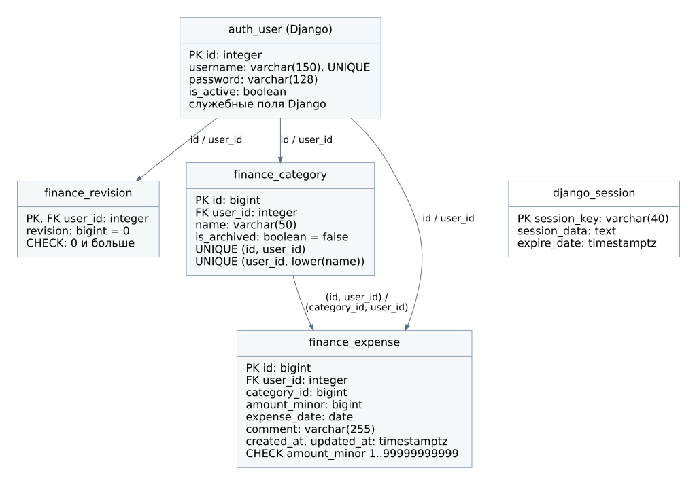

# Физическая схема

Целевая СУБД: PostgreSQL 17. Веб-приложение использует Django 5.2 и штатную модель пользователя. При реализации схему создают миграции Django. Собственные первичные ключи категорий и расходов имеют тип `bigint`; ссылки на стандартную `auth_user.id` имеют тип `integer`.

## `auth_user`

Стандартная таблица Django. Для проекта используются `id integer PRIMARY KEY`, `username varchar(150) UNIQUE NOT NULL`, `password varchar(128) NOT NULL`, `is_active boolean NOT NULL`, `date_joined timestamptz NOT NULL`, `last_login timestamptz NULL`. Поля имени, фамилии, e-mail, `is_staff` и `is_superuser` сохраняются в стандартной модели, но отдельного пользовательского интерфейса для них нет. Логин в первой версии регистрозависимый, как в штатной модели Django.

Таблицы разрешений, групп, типов содержимого и миграций создаёт инфраструктура Django. Они не добавляют пользовательские роли в предметную область и не содержат расходов.

## `finance_revision`

| Поле | Тип | Ограничение |
| --- | --- | --- |
| `user_id` | integer | PK, FK → `auth_user.id`, NOT NULL |
| `revision` | bigint | NOT NULL, DEFAULT 0, CHECK (`revision >= 0`) |

Удаление пользователя с данными через интерфейс не предусмотрено. Для технических FK на пользователя используется `ON DELETE RESTRICT`. Запись ревизии создаётся при регистрации в одной транзакции с аккаунтом. Ограничения ON DELETE на уровне PostgreSQL задаются миграциями; параметр `on_delete` Django сам по себе описывает поведение ORM и не заменяет эти ограничения.

## `finance_category`

| Поле | Тип | Ограничение |
| --- | --- | --- |
| `id` | bigint | GENERATED BY DEFAULT AS IDENTITY, PK |
| `user_id` | integer | NOT NULL, FK → `auth_user.id`, ON DELETE RESTRICT |
| `name` | varchar(50) | NOT NULL, CHECK (`name = btrim(name)` AND `char_length(name) > 0`) |
| `is_archived` | boolean | NOT NULL, DEFAULT false |

Ограничение `UNIQUE (id, user_id)` служит целью составного FK расходов. Уникальный индекс `uq_category_owner_name` по `(user_id, lower(name))` не допускает два одинаковых названия у одного владельца. Архивные строки участвуют в этом индексе.

## `finance_expense`

| Поле | Тип | Ограничение |
| --- | --- | --- |
| `id` | bigint | GENERATED BY DEFAULT AS IDENTITY, PK |
| `user_id` | integer | NOT NULL, FK → `auth_user.id`, ON DELETE RESTRICT |
| `category_id` | bigint | NOT NULL, часть составного FK |
| `amount_minor` | bigint | NOT NULL, CHECK (`amount_minor BETWEEN 1 AND 99999999999`) |
| `expense_date` | date | NOT NULL |
| `comment` | varchar(255) | NOT NULL, DEFAULT '' |
| `created_at` | timestamptz | NOT NULL, DEFAULT CURRENT_TIMESTAMP |
| `updated_at` | timestamptz | NOT NULL, DEFAULT CURRENT_TIMESTAMP |

Составной FK `(category_id, user_id)` ссылается на `finance_category(id, user_id)` с `ON DELETE RESTRICT`. В Django связь с категорией описывается `ForeignKey(..., on_delete=PROTECT)`, а дополнительный составной FK устанавливается миграцией `RunSQL`. Штатного FK только по `category_id` недостаточно, чтобы обеспечить совпадение владельцев на уровне БД.

Индексы:

- `ix_expense_owner_date (user_id, expense_date DESC, id DESC)` для списка и выборки месяца.
- `ix_expense_owner_category_date (user_id, category_id, expense_date DESC)` для фильтра по категории и проверки её использования.

`updated_at` изменяет сервис при редактировании. Само наличие DEFAULT не обновляет колонку при UPDATE. Признак архива категории проверяется в приложении внутри транзакции с блокировкой строки категории.

## `django_session`

Штатная таблица: `session_key varchar(40) PRIMARY KEY`, `session_data text NOT NULL`, `expire_date timestamptz NOT NULL`, индекс по `expire_date`. Истёкшие сессии удаляются регулярной командой Django `clearsessions`.

## Разделение проверок

БД обеспечивает внешние ключи, диапазон суммы, обязательность полей и уникальность. Приложение обеспечивает аутентификацию, доступ владельца, допустимость архивной категории и перевод рублей в копейки. Проверка в форме улучшает сообщение об ошибке, но не заменяет ограничения БД.

