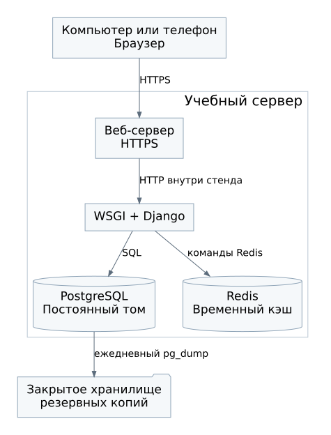

# Архитектура

## Выбор

Монолитное веб-приложение: Python 3.12, Django 5.2, серверные HTML-шаблоны, PostgreSQL 17 и Redis 8. Для первой версии не нужны отдельное SPA, очередь фоновых задач и микросервисы. Один разработчик сможет реализовать формы и правила доступа средствами Django и сосредоточиться на корректности учёта.

Redis используется для кэширования повторяющейся месячной агрегации. Его включение не предполагает заранее доказанного ускорения. При реализации сравниваются доля попаданий, время ответа и число агрегаций. Если на выбранной нагрузке кэш не даёт пользы, прямой расчёт по БД остаётся работоспособным вариантом.

## Развёртывание

Веб-сервер принимает HTTPS и передаёт запросы WSGI-приложению Django. Приложение, PostgreSQL и Redis находятся в закрытой сети одного учебного стенда. Для развёртывания можно использовать Docker Compose. БД имеет постоянный том и резервные копии. У Redis сохранять восстанавливаемые сводки на диск не требуется.

Конфигурация передаётся через окружение: ключ Django, параметры PostgreSQL, адрес Redis и допустимые хосты. Секреты не хранятся в репозитории. Точные минорные версии зависимостей фиксируются при реализации. Для доклада используется отдельный проверенный образ Redis из каталога презентации.

## Запись данных

Вход и права проверяются до изменения. В транзакции Django сервис блокирует выбранную категорию, проверяет её состояние, сохраняет расход и увеличивает ревизию SQL-выражением. Для операций с категорией изменение и ревизия также фиксируются вместе. Ответ об успехе отправляется после COMMIT.

Проверки в интерфейсе не заменяют серверные. Переход к форме удаления через GET не удаляет запись; изменение выполняется только POST с CSRF-проверкой.

## Чтение сводки

Используется cache-aside с версией в ключе. Перед обращением к Redis приложение читает ревизию из PostgreSQL. При промахе оно выполняет одну агрегацию, проверяет ревизию повторно и при её совпадении записывает JSON с TTL 60 секунд. Внутри ключа есть версия формата `v1`, пользователь, ревизия и месяц.

Одна ревизия пользователя инвалидирует все его месяцы. Это проще отдельного счётчика на каждый месяц и корректно работает при переносе расхода из одного месяца в другой. Цена такого решения: после любого изменения несколько сводок могут потребовать повторного расчёта.

## Отказы и ограничения

| Ситуация | Поведение |
| --- | --- |
| Нет ключа или истёк TTL | Расчёт по PostgreSQL и попытка заполнить кэш |
| Redis недоступен | Расчёт по PostgreSQL, сохранение расходов продолжает работать |
| JSON кэша не прошёл проверку | Значение считается промахом |
| Ошибка записи в Redis | Уже рассчитанная сводка возвращается пользователю |
| PostgreSQL недоступна | Явная ошибка чтения или сохранения; нулевые данные и успех не имитируются |
| Данные изменились во время расчёта | Результат не записывается в кэш; следующий запрос использует новую ревизию |

Одновременный промах нескольких запросов может вызвать повторные агрегации. Распределённая блокировка заполнения кэша в первую версию не входит. При большой нагрузке этот риск оценивается по измерениям. Уже начавшийся запрос может увидеть состояние до конкурентного изменения, поэтому строгая актуальность в момент получения ответа не обещается.

## Реализация по этапам

1. Аутентификация, миграции и изоляция пользователей.
2. Категории, расходы, фильтры и транзакционное изменение ревизий.
3. Сводка напрямую по PostgreSQL и проверки денежных сумм.
4. Подключение Redis, обработка промаха и отказа.
5. Проверки сценариев, интерфейса, нагрузки и восстановления.

Консольная демонстрация Redis использует SQLite и воспроизводит только механизм сводки, а не всю эту архитектуру.

