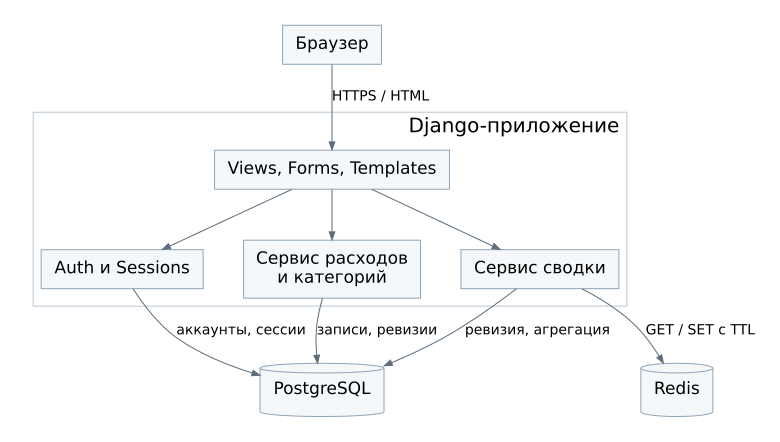

# Компонентная модель

Приложение строится как один Django-проект. Внутренние модули разделяют обязанности, но не развёртываются как отдельные микросервисы.

| Компонент | Ответственность | Основные зависимости |
| --- | --- | --- |
| Браузер | Формы, навигация, показ списков и сводки | HTTPS к Django через веб-сервер |
| Views, Forms, Templates | Маршруты, проверка формы, HTML-ответ, CSRF и вход | Аутентификация, сервисный слой |
| Сервис расходов и категорий | Проверки владельца и архива, запись, транзакции, ревизии | Django ORM, PostgreSQL |
| Сервис сводки | Ключ кэша, чтение, агрегация, проверка результата | ORM и клиент Redis |
| Django Auth и Sessions | Проверка пароля, вход, выход, сессии | PostgreSQL |
| PostgreSQL | Постоянные данные и ограничения целостности | Внутреннее подключение приложения |
| Redis | Временные JSON-сводки с TTL | Команды клиента приложения |

## Взаимодействие модулей

Views получают текущего пользователя из сессии и передают его идентификатор сервису. Произвольный `user_id` из формы не становится владельцем записи. Формы дают сообщения об ошибках, сервисы повторно проверяют правила, а БД обеспечивает ограничения.

Сервис записи не обращается к Redis. Он меняет исходные данные и ревизию в PostgreSQL. Сервис сводки читает актуальную ревизию, поэтому сам выбирает новый ключ после изменения. Клиент Redis обрабатывает сетевые ошибки и ограничивает ожидание по NFR-04.

## Границы компонентов

Браузер не подключается к БД и Redis напрямую. Redis не выполняет SQL и не следит за изменением таблиц. Приложение не использует Redis как единственное хранилище расходов или сессий.

