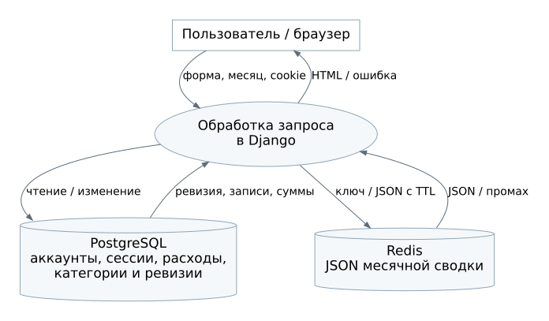
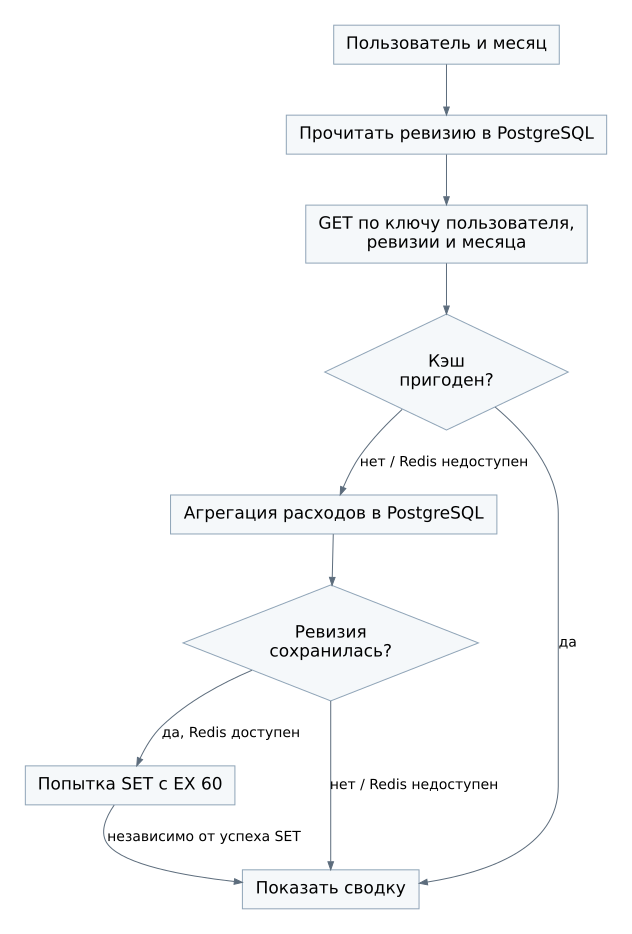

# Потоки данных

## D-01. Регистрация и вход

Браузер отправляет логин и пароль по HTTPS. Django проверяет форму и пароль. При регистрации в PostgreSQL появляются аккаунт, ревизия и категории. При входе PostgreSQL хранит сессию, браузер получает cookie с её идентификатором. Пароль, cookie и содержимое сессии не отправляются в Redis и не попадают в логи.

## D-02. Сохранение расхода

Входные данные: сумма в рублях, дата, идентификатор категории и комментарий. Владелец поступает из серверной сессии. Сервис переводит сумму в целые копейки и в транзакции сохраняет расход и новую ревизию. Выход: перенаправление на список и сообщение об успехе либо форма с ошибкой.

Прямого потока «PostgreSQL обновляет Redis» нет. После COMMIT новая ревизия становится доступна следующим запросам сводки.

## D-03. Сводка

1. Браузер передаёт месяц, сервер определяет пользователя.
2. PostgreSQL возвращает ревизию.
3. Приложение строит ключ и выполняет GET в Redis.
4. При корректном попадании JSON преобразуется в данные страницы.
5. При промахе или отказе Redis PostgreSQL возвращает сгруппированные суммы.
6. Приложение сверяет ревизию. При совпадении пытается выполнить SET с EX 60.
7. Пользователь получает сводку независимо от успеха записи в кэш, если расчёт по основной БД завершился успешно.

## Форматы и границы

| Поток | Формат | Проверка |
| --- | --- | --- |
| Браузер → Django | HTTPS, HTML-формы, query-параметры | Сессия, CSRF для изменений, формат полей |
| Django → PostgreSQL | ORM и параметризованные SQL-запросы | Ограничения, транзакция, владелец |
| PostgreSQL → Django | Записи или сгруппированные суммы в копейках | Согласованность ревизии при заполнении кэша |
| Django → Redis | Ключ, JSON, TTL 60 с | Версия формата, пользователь и месяц в ключе |
| Redis → Django | JSON либо отсутствие ключа | Структура, пользователь, месяц, формат и сумма строк |
| Django → браузер | HTML | Экранирование комментариев и названий категорий |

Cookie является непрозрачным идентификатором сессии. Доверять переданным клиентом владельцу, сумме сводки или признаку администратора нельзя. Redis обслуживается только приложением внутри закрытой сети.

## Пример согласованности

При ревизии 4 итог октября равен 720,00. Добавление 80,00 и увеличение ревизии до 5 фиксируются вместе. Новый запрос ищет ключ с `r:5`, рассчитывает 800,00 и сохраняет новый результат. Старый ключ с `r:4` может оставаться до TTL, но новые запросы после фиксации изменения его больше не выбирают.

